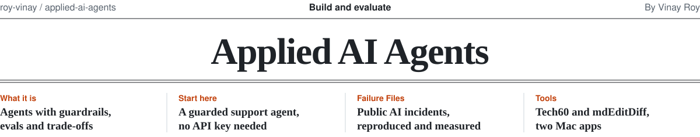
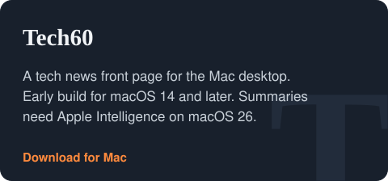
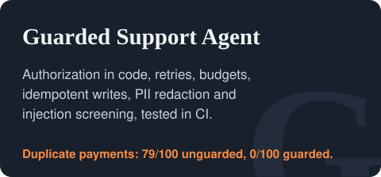
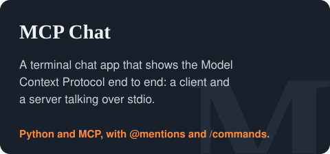
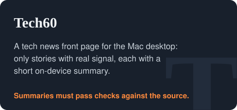
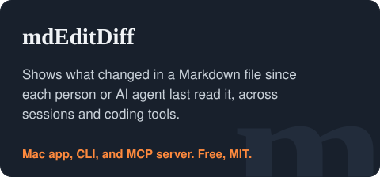
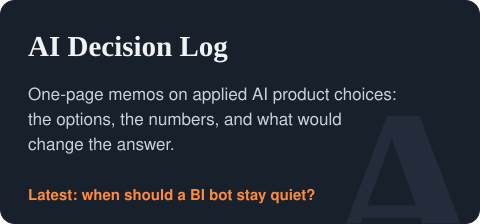

<picture>
  <source media="(prefers-color-scheme: dark)" srcset=".github/assets/masthead-dark.svg">
  
</picture>

[](https://github.com/roy-vinay/applied-ai-agents/actions/workflows/evals.yml)

Each project starts from a real problem, builds the smallest version that works, tests the behavior that
matters, and writes down what was traded away. Results come with their method and caveats, and claims stop
where the evidence does.

## Mac app downloads

<a href="https://github.com/roy-vinay/applied-ai-agents/releases/download/tech60-latest/Tech60-macOS.zip"><picture><source media="(prefers-color-scheme: dark)" srcset=".github/assets/card-download-tech60-dark.svg"></picture></a>
<a href="https://github.com/roy-vinay/mdeditdiff/releases/latest/download/mdEditDiff-macOS.zip"><picture><source media="(prefers-color-scheme: dark)" srcset=".github/assets/card-download-mdeditdiff-dark.svg"></picture></a>

Release notes: [Tech60](https://github.com/roy-vinay/applied-ai-agents/releases/tag/tech60-latest), [mdEditDiff](https://github.com/roy-vinay/mdeditdiff/releases/latest). Both apps are not yet notarized; follow the first-launch instructions in their documentation.

**Start here**

- **Build and evaluate agents:** [run the guarded support agent](#build-and-evaluate-agents) in under a minute, no API key needed.
- **Explore failure experiments:** [Failure Files](#explore-failure-experiments), public AI incidents reproduced and mitigations measured.
- **Try the tools:** [Tech60 and mdEditDiff](#try-the-tools), two Mac apps.
- **Read the decisions and roadmap:** [decisions and roadmap](#read-the-decisions-and-roadmap).

## Build and evaluate agents

The fastest start needs no API key and no dependencies:

```bash
git clone https://github.com/roy-vinay/applied-ai-agents
cd applied-ai-agents/production-patterns/guarded-support-agent
python demo.py               # four scenarios with the full tool trace
python -m evals.run_evals    # 12 trajectory evals, the same suite CI runs
```

### Production patterns

The parts that keep an agent safe once real users and real money are involved.

<a href="production-patterns/guarded-support-agent"><picture><source media="(prefers-color-scheme: dark)" srcset=".github/assets/card-guarded-support-agent-dark.svg"></picture></a>

Companion to [Building AI Agents That Survive Production](https://vinaysays.medium.com/building-ai-agents-that-survive-production-5bbb2257ba0a).

**What the guards prevent** under fault injection, 100 randomized trials per row, same agent with guards off vs on
([method and caveats](production-patterns/guarded-support-agent#what-the-guards-actually-prevent)):

| Outcome | How it arises | Guards off | Guards on |
| --- | --- | ---: | ---: |
| Duplicate payment after a lost response | Injected environment fault | 79/100 | 0/100 |
| Refund paid on another customer's order | Input: customer names any order | 47/100 | 0/100 |
| Refund over $50 paid without approval | Input: any eligible order | 25/100 | 0/100 |
| Payment made after an injection attempt (attack success) | Adversarial input | 68/100 | 18/100 |
| Card number shown back to the customer | Injected model failure, every trial | 100/100 | 0/100 |
| System prompt revealed | Injected model failure, every trial | 100/100 | 0/100 |
| Turn ran past 8 model calls | Injected model failure, every trial | 100/100 | 0/100 |
| Legitimate refund wrongly blocked (false positive) | Ordinary requests | 0/100 | 0/100 |

### Agents

<a href="agents/mcp-chat"><picture><source media="(prefers-color-scheme: dark)" srcset=".github/assets/card-mcp-chat-dark.svg"></picture></a>

## Explore failure experiments

**Failure Files** take a documented public AI incident, reproduce the failure mode in a fictional system, and
measure mitigations one at a time. Every file uses the shared terms in [METHODS.md](METHODS.md).
[All files](failure-files).

<a href="failure-files/ff-05-rules-in-the-prompt"><picture><source media="(prefers-color-scheme: dark)" srcset=".github/assets/card-ff-05-dark.svg"></picture></a>
<a href="failure-files/ff-01-unsupported-policy-claims"><picture><source media="(prefers-color-scheme: dark)" srcset=".github/assets/card-ff-01-dark.svg"></picture></a>

## Try the tools

Two free, open-source Mac apps. Both are early.

<a href="tools/tech60"><picture><source media="(prefers-color-scheme: dark)" srcset=".github/assets/card-tech60-dark.svg"></picture></a>
<a href="https://github.com/roy-vinay/mdeditdiff"><picture><source media="(prefers-color-scheme: dark)" srcset=".github/assets/card-mdeditdiff-dark.svg"></picture></a>

**[Tech60](tools/tech60)**: a tech news front page for the Mac desktop. It shows only stories with signal
(several outlets, a Techmeme pick, or the company's own post) and gives each a short summary from Apple's
on-device model. Rule-based checks withhold a summary whose numbers or names don't appear in the source, or
whose sentences don't overlap a source sentence. Those checks catch some errors, not all; the accuracy
evaluation hasn't been run yet. [Download for Mac](https://github.com/roy-vinay/applied-ai-agents/releases/download/tech60-latest/Tech60-macOS.zip)
(macOS 14 or later), or [read how it works](tools/tech60).

**[mdEditDiff](https://github.com/roy-vinay/mdeditdiff)**: an editor for people and a diff for agents. Agents
ask what changed in a shared Markdown file since they last looked and get back only the changed parts; people
get a native Mac app for reading and editing Markdown. The app, CLI, MCP server, releases, and
[website](https://roy-vinay.github.io/mdeditdiff/) all live in [its own repository](https://github.com/roy-vinay/mdeditdiff).
Releases up to 0.5.3 also remain on this repository's Releases page, so older download links keep working.

## Read the decisions and roadmap

<a href="https://github.com/roy-vinay/ai-decision-log"><picture><source media="(prefers-color-scheme: dark)" srcset=".github/assets/card-ai-decision-log-dark.svg"></picture></a>

The reasoning behind the builds lives in **[ai-decision-log](https://github.com/roy-vinay/ai-decision-log)**:
one-page memos on applied AI product choices, with the numbers, the decision, and what would change it.
Start with [D-002: How many evals are enough?](https://github.com/roy-vinay/ai-decision-log/blob/main/decisions/D-002-how-many-evals-are-enough.md).

What's shipped, what's next, and the hypothesis behind each: [ROADMAP.md](ROADMAP.md).

## About

<a href="https://www.linkedin.com/in/royvinay"><picture><source media="(prefers-color-scheme: dark)" srcset=".github/assets/about-dark.svg"></picture></a>

VP of Product at [Burq.ai](https://burq.ai), leading Product and AI.

Before Burq, I was the founding product leader at an AI SaaS startup, taking it from zero to product-market fit and building multi-agent systems in production. Before that, I led a global team of about 80 across Product, Data Science and Analytics at Vista, the private aviation group behind VistaJet and XO.<br>
Earlier: marketplace growth at Zeus Living, macOS and iOS features at Apple (including Sidecar), and engineering teams at Qualcomm and NVIDIA.

For seven years I was Head Instructor for the AI/ML executive program at UC Berkeley Executive Education, teaching more than 10,000 business leaders. 3 US patents, MBA from Berkeley Haas, MS from IIT Roorkee.

<picture>
  <source media="(prefers-color-scheme: dark)" srcset="https://raw.githubusercontent.com/roy-vinay/roy-vinay/main/dark_mode.svg">
  
</picture>

## License

MIT, unless a project folder says otherwise.
