<picture>
  <source media="(prefers-color-scheme: dark)" srcset="../../.github/assets/brand-review-masthead-dark.svg">
  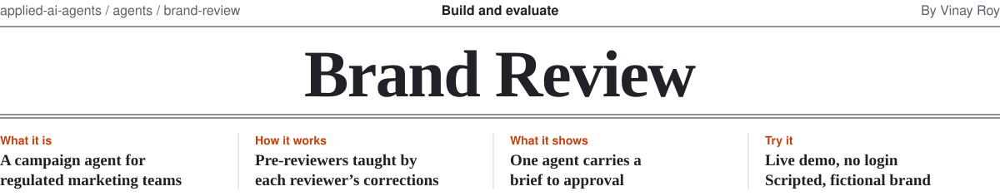
</picture>

**Brand Review is an agent that turns a marketing brief into on-brand graphics for every channel, and gets
them approved.** Generating the assets is table stakes; in a bank or an insurer, approval is where campaigns
stall for a week. So reviewers teach their own pre-review agents through their corrections, and known
objections are fixed before anyone looks.

<p>
<a href="https://brand-review-demo.vercel.app/live/"><picture><source media="(prefers-color-scheme: dark)" srcset="../../.github/assets/btn-brand-review-live-dark.svg"></picture></a>
<a href="https://brand-review-demo.vercel.app"><picture><source media="(prefers-color-scheme: dark)" srcset="../../.github/assets/btn-brand-review-walkthrough-dark.svg">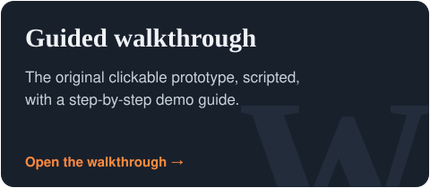</picture></a>
<a href="https://brand-review-demo.vercel.app/web/"><picture><source media="(prefers-color-scheme: dark)" srcset="../../.github/assets/btn-brand-review-playground-dark.svg">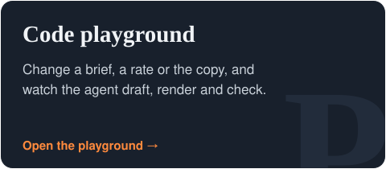</picture></a>
<a href="https://github.com/roy-vinay/ai-decision-log/blob/main/decisions/D-004-what-should-a-content-agent-fix-first.md"><picture><source media="(prefers-color-scheme: dark)" srcset="../../.github/assets/btn-brand-review-memo-dark.svg">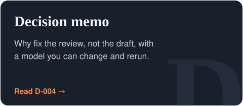</picture></a>
</p>

No login, works best on a laptop. Jump to: [the code](#the-code) · [how it works](#how-it-works) · [decisions](#decisions-and-trade-offs)

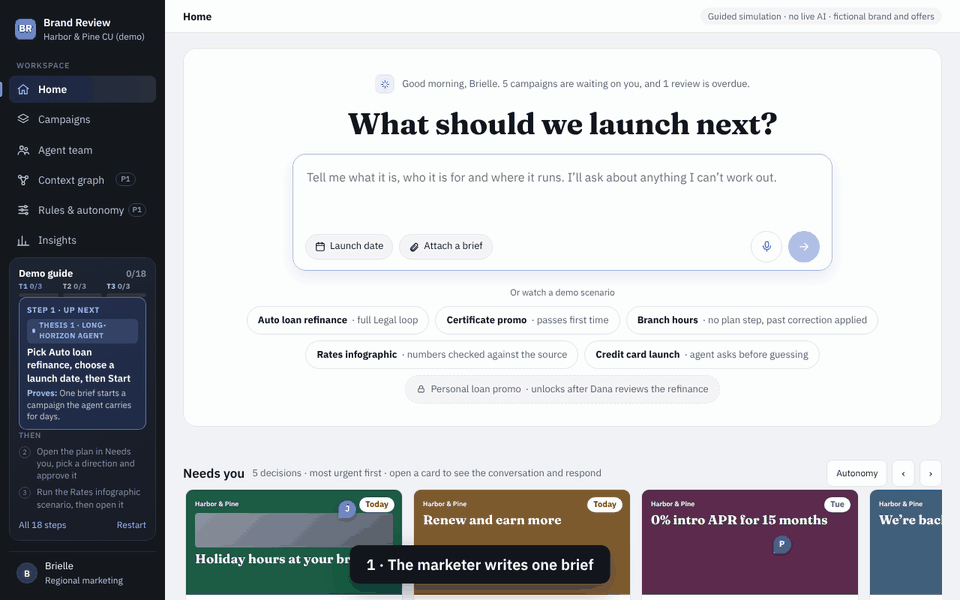

## At a glance

| | |
| --- | --- |
| **For** | Marketing teams at banks, credit unions and insurers, where every claim passes Legal, Brand and Compliance |
| **The bet** | Most review rounds come from rules reviewers never wrote down. Capture those, and rounds fall. |
| **What's new** | Each reviewer owns a pre-review agent that learns from their corrections. No model is retrained. |
| **What it makes** | Social posts (1:1, 4:5, 9:16), display banners (300x250, 728x90) and sourced rate infographics, each with its own layout. Flyers and brochures are next. |
| **What it won't let through** | A rate with no disclaimer, text below contrast minimums, a chart figure that doesn't match its source |
| **Measured in replay** | 29% fewer review rounds and repeat corrections from 104 to 3 a quarter, with zero out-of-scope edits ([benchmark](#the-code), simulated reviewers). The [D-004](https://github.com/roy-vinay/ai-decision-log/blob/main/decisions/D-004-what-should-a-content-agent-fix-first.md) model predicted about 30%. |
| **Status** | Working Python core (drafting, rendering, rules, lessons, retrieval, pre-review, workflow) with 23 must-pass evals and a replay benchmark in CI, plus a clickable web demo. Fictional brand. |

## Three bets

1. **One agent owns each campaign.** It works in bursts, waits days on people when it has to, and only brings
   the marketer decisions.
2. **Reviewers teach their own agents.** A correction with a reason becomes a scoped, owned lesson that later
   drafts apply before the reviewer sees them.
3. **Review is the product.** Each reviewer gets a no-login link with one decision, their past rulings, and a
   suggested fix. The agent nudges on the due date, never before a date the reviewer committed to.

| The reviewer's view | Every change explained |
| --- | --- |
| 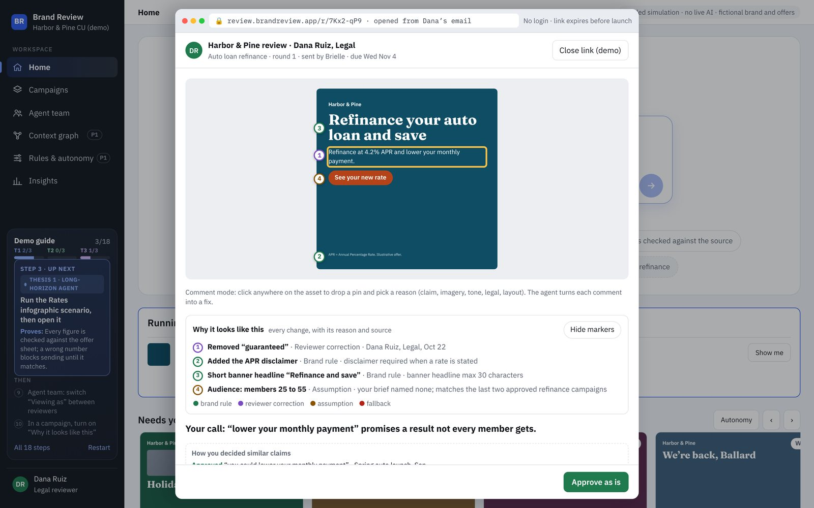 | 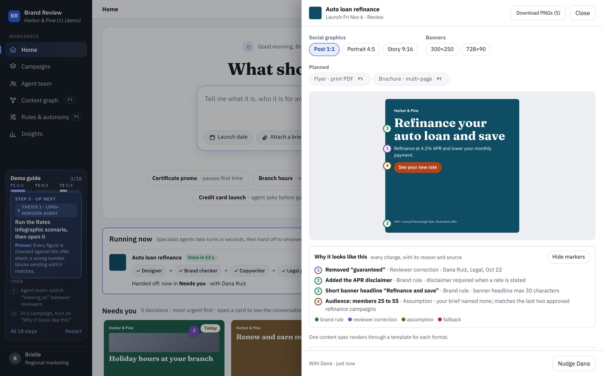 |

## The code

The agent is implemented in Python, standard library only, no API key. These were generated by it from two
briefs and an offer sheet, through the full pipeline (draft, pre-review, render, check what was drawn):

| Post 1:1 | Portrait 4:5 | Story 9:16 | Rate infographic |
| --- | --- | --- | --- |
| 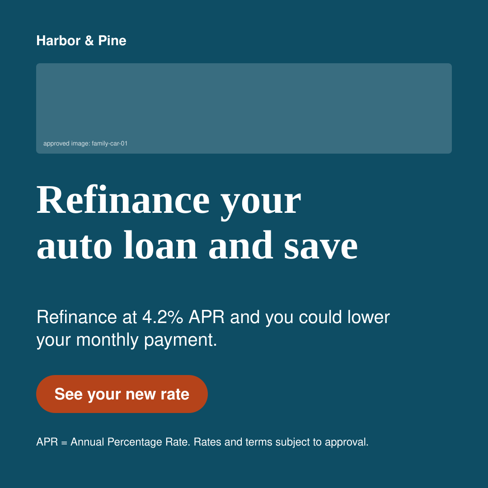 | 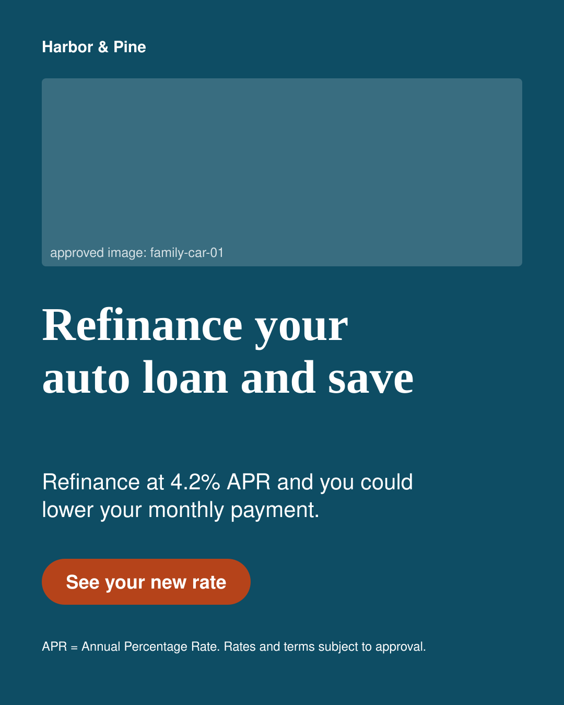 | 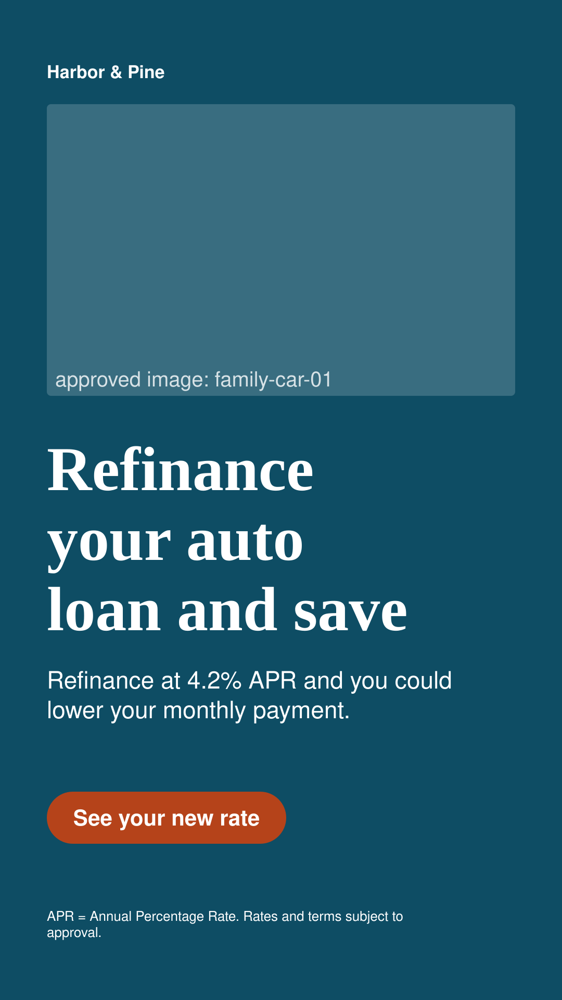 | 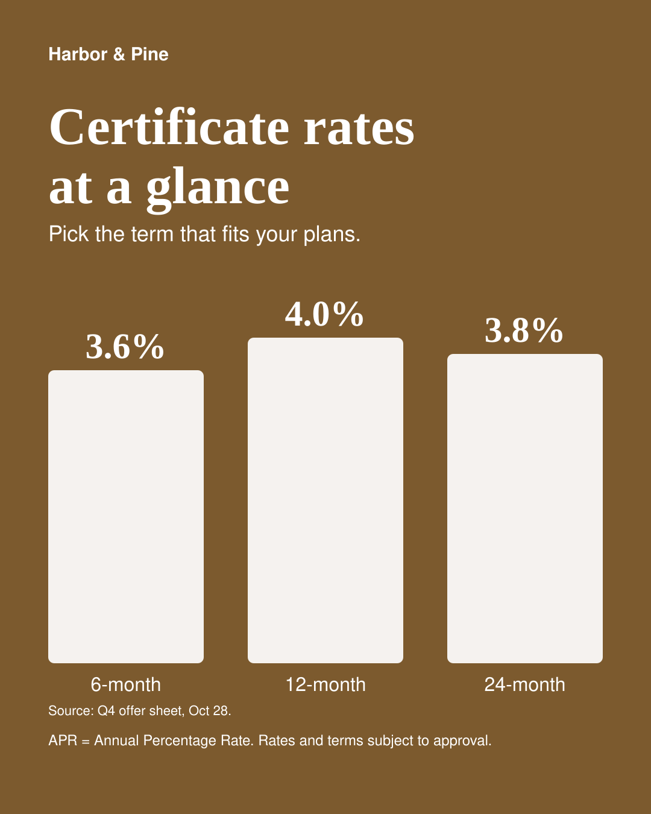 |

| Display 300x250 | Leaderboard 728x90, re-laid out with the short headline |
| --- | --- |
|  |  |

**[Run it in your browser](https://brand-review-demo.vercel.app/web/):** this page loads the files from `agent/`
and runs them with Pyodide (Python compiled to WebAssembly). Change the brief, the offer sheet or the copy,
and the real drafter, pre-review, renderer and checks run on your machine. It can run the 23 evals too. The
clickable product demo above is separate and scripted; this one is the code.

**[The same demo, running the real code](https://brand-review-demo.vercel.app/live/):** a copy of the clickable demo,
built by `live/build.py` from the original without changing it. In the copy, every ad is drawn by
`agent/render.py`, the brand checks and "blocks sending" come from `agent/rules.py` and the render checks,
the refinance directions come from `agent/drafter.py`, and Dana's lesson is learned, applied to the personal
loan, and retired by `agent/lessons.py`. Nudges, deadlines, insights numbers and agent run timings stay
scripted, and the page says so. CI fails if the copy can't be rebuilt from the original.

Or run it locally:

```bash
git clone https://github.com/roy-vinay/applied-ai-agents
cd applied-ai-agents/agents/brand-review
python demo.py                      # brief to formats to review to lessons, with a full trace
python render_examples.py           # regenerate the graphics above into docs/formats/
python -m evals.run_evals           # 23 must-pass evals, the same suite CI runs
python -m benchmark.replay --check  # replay a quarter of campaigns, with and without lessons
```

| Module | What it does |
| --- | --- |
| [`agent/drafter.py`](agent/drafter.py) | Brief in, content spec out, in three creative directions. Every number comes from the offer sheet; if a fact is missing, it asks instead of guessing. Pluggable: an LLM drafter uses the same interface. |
| [`agent/render.py`](agent/render.py) | One spec, every format, each with its own layout and text fitting (not scaled). Infographic bars start at zero and print their source. Then checks run on what was actually drawn: disclaimer in full, every printed number in the offer sheet, nothing overflowing. |
| [`agent/pipeline.py`](agent/pipeline.py) | Draft, pre-review, render, check. |
| [`agent/rules.py`](agent/rules.py) | Written brand rules: WCAG contrast, disclaimer when a rate is stated, banner length, approved images, every printed figure checked against the offer sheet. Safe fixes are automatic; figures never are. |
| [`agent/lessons.py`](agent/lessons.py) | A reviewer's correction becomes a lesson with an owner, reason, scope and status. Only the owning function can promote or retire it; unused lessons go stale. |
| [`agent/retrieval.py`](agent/retrieval.py) | Picks lessons by reviewing function, product line, product and region. Conflicting lessons are never applied. |
| [`agent/prereview.py`](agent/prereview.py) | Routes the draft, applies lessons, applies safe rule fixes, re-checks, and returns every change with its source. |
| [`agent/workflow.py`](agent/workflow.py) | The campaign state machine. Skipping review, sending a blocked draft, or publishing without a person raises. |

### What the replay measures

A seeded quarter of 120 campaigns across loans, mortgages, certificates, cards and branches, averaged over
20 seeds. Simulated reviewers enforce six unwritten rules, each with a true scope, and skim: they spot 75% of
what's wrong per round. Lessons learn the exact words a reviewer struck, so a paraphrase can slip past them.

| | No lessons | Unscoped lessons | Scoped lessons |
| --- | ---: | ---: | ---: |
| Review rounds per campaign | 1.84 | 1.31 | **1.31** |
| First-pass approval | 31% | 70% | **70%** |
| Repeat corrections per quarter | 104 | 3 | **3** |
| Edits outside the reviewer's intended scope | 0 | **18** | **0** |
| Campaigns with an issue that escaped review | 17.7% | 8.7% | **8.7%** |
| Wrong figures blocked before review | 6 of 6 | 6 of 6 | 6 of 6 |

- **Scope is what makes lessons safe.** Unscoped lessons cut rounds just as much, but strip "guaranteed" from
  fixed-rate certificates, where it's accurate. That's 18 wrong edits a quarter a reviewer would have to catch.
- **It learns fast.** With scoped lessons, rounds go from 1.42 in month one to 1.26 by month three; without
  them, 1.90 to 1.77.
- **Fewer escapes, not more.** Fewer issues reach the reviewer, so fewer slip past a skimming one.

**Caveats.** The reviewers and campaigns are simulated, and the copy reuses a small set of phrasings, so
lesson recall here (97%) is higher than real copy would allow. The value is in the comparisons and the
properties CI enforces, not the absolute numbers. The next step is replaying a real team's past review
comments.

## Why this, why now

### The problem

Three things cause most review rounds in regulated marketing:

1. **Nobody owns the next step.** Work sits between handoffs, waiting on whoever remembers it.
2. **Reviewers enforce rules nobody wrote down.** Legal strikes "guaranteed" from every loan ad, and the same
   fix gets made on every campaign.
3. **Reviewers get whole files with no context.** They skim, one miss surfaces late, and the loop restarts.

Better generation fixes none of these.

### Who it's for

| Role | What they need | What they get |
| --- | --- | --- |
| **Marketer** (daily user) | Ship on time without chasing people | Only decisions reach them; the agent chases |
| **Legal, Brand, Compliance** (must adopt, never asked to) | Fewer, better review requests | One decision per link, no login, and an agent that stops repeating old mistakes |
| **Marketing ops lead** (buyer) | Predictable launch dates, no compliance incidents | Time to approval, rounds, and missed issues, per team |

The reviewers are the adoption risk. They don't choose the tool, so the review link has to be easier than
email, or it fails.

### Why now

- **Agents can now run for days.** Durable workflows keep state and timers alive while people are away.
- **Agents can act where reviewers already work.** Email, Slack and workflow tools, not a new login.
- **Generation within hard constraints is reliable enough** when text is templated and image models fill only
  image slots.

### Where existing tools stop

| Category | What it does well | Where it stops | What I'd take |
| --- | --- | --- | --- |
| Design tools with locked templates | AI can't move locked elements; low-risk templates skip approval | Reviewer decisions are logged, not fed into the next draft | Locked elements and risk-based routing |
| Content suites with brand scoring | Per-attribute brand score, approvals through a workflow system | Checks follow documented guidelines, not each reviewer's past calls | The per-attribute score, and keeping the workflow system as record |
| Data-to-chart tools | Spreadsheet to branded chart in seconds | Nothing ties a printed number back to its source | The import flow |
| Ad resizing tools | One design adapted across sizes | Resizing, not compliance | Per-size layout rules |
| General chat assistants | The bar for briefs and image quality | Text drawn into an image can't be edited or checked | Conversational briefs, image models for images only |

**The gap:** these tools help make or grade the asset. None I've found uses a reviewer's past decisions to
shape the next draft. That is the part only a customer's own reviewers can teach, which makes it hard to copy.

### What I'd build first, and what I wouldn't

| Build first | Later | Not in V1 |
| --- | --- | --- |
| Social posts, banners, single-page infographics from sourced tables | Flyers (print), more pre-reviewers, promoting lessons to rules | An image model of our own |
| Planner, Copywriter, Designer, Brand checker, Legal pre-reviewer | Calendar, localization | A pro design tool or co-editing |
| Checks and score, Home, the review link with routing and nudges | Brochures, motion, auto-approval of low-risk work | Publishing ads, or customer-built agents |

Ranked by fewer review rounds first, then defensibility, then what one team can ship in a quarter.


## Try it: a 10-minute tour

The Demo guide in the left rail walks through this.

1. Start **Auto loan refinance**, pick a launch date, approve the plan.
2. Watch the specialists build, self-check and fix before review.
3. Send it to Legal, then open **Dana's review link** and take the suggested fix.
4. Start **Personal loan promo**. The agent applies Dana's lesson before she sees it.
5. In **Agent team**, retire that lesson and run the promo again: Dana has to repeat herself.
6. Try **Rates infographic**: a chart figure that doesn't match its source blocks sending.

### What's real and what's simulated

| Part | In this prototype |
| --- | --- |
| Drafting copy | **Real, deterministic** in the Python core: approved copy patterns per product, filled only with offer-sheet facts. An LLM drafter can plug in without changing anything downstream. The web demo's drafting is scripted. |
| Rendering formats | **Real** in the Python core: six SVG layouts with text fitting and render checks |
| Image generation | **Not built.** Image slots take approved library assets only; an image model would fill only those slots, never text |
| Rules, lessons, scoped retrieval, pre-review, workflow | **Real**, in the Python core ([`agent/`](agent)), tested in CI |
| Brand checks in the web demo | Real checks on the content; edit a headline and they re-run |
| Per-format layouts | Real templates rendering one content spec five ways |
| Lessons in the web demo | Scripted for the demo scenarios; the real logic is in the Python core |
| Insights page metrics | **Seeded, illustrative.** How a pilot would be measured, not results |
| Brand, people, offers | Fictional |


## How it works

### Architecture

<picture>
  <source media="(prefers-color-scheme: dark)" srcset="docs/architecture-dark.svg">
  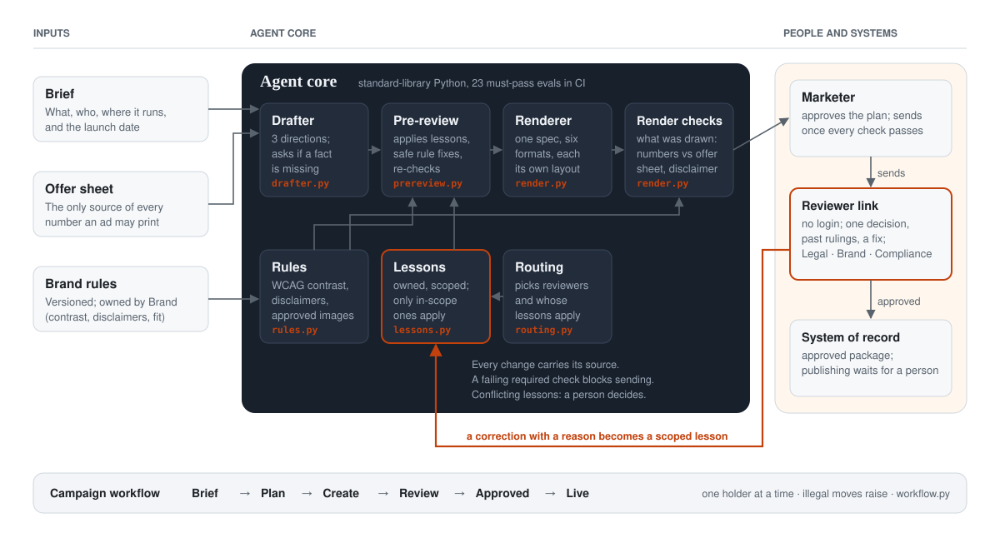
</picture>

- **Agents fill templates; they don't draw text.** Brand rules compile into template constraints, and a renderer
  draws every format from one content spec. Text stays editable and checkable.
- **A durable workflow engine** keeps each campaign's state and timers alive across days of waiting.
- **Each agent is a versioned job description** with its own memory and an eval set every edit must pass, so a
  bad edit can be rolled back.

### Campaign lifecycle

Every campaign moves through six stages. At any moment exactly one party holds it: the marketer, a reviewer,
an agent, or the clock.

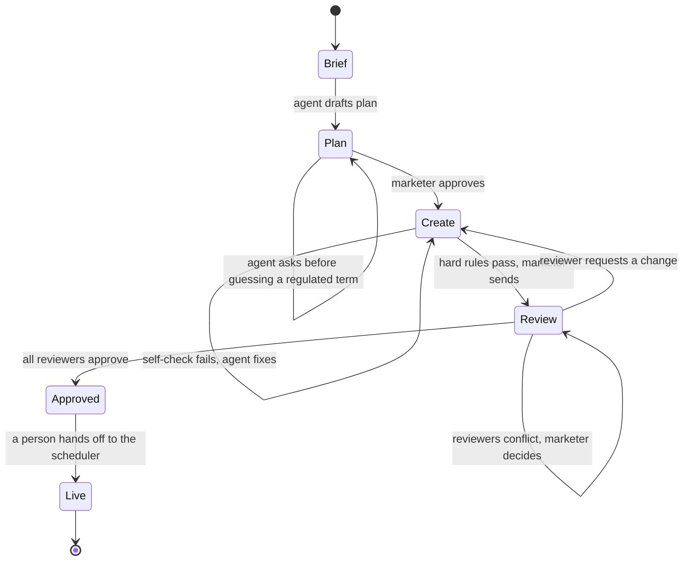

### A lesson

A reviewer's correction becomes a record like this. Every field is something a person can audit.

```json
{
  "id": "lsn_0142",
  "text": "Write 'could lower', not 'lower', in payment claims",
  "reason": "claim",
  "owner": "Legal",
  "taught_by": { "reviewer": "Dana Ruiz", "campaign": "Auto loan refinance", "asset_version": "v3" },
  "scope": { "product_line": "lending", "region": "all", "claim_type": "payment" },
  "status": "context",
  "uses": 1,
  "repeats_avoided": 1,
  "last_used": "2026-10-31"
}
```

- **Status** moves from `context` (guides the agent) to `proposed` to `rule` (enforced). Only the owning
  function can promote or retire a lesson.
- **Retrieval** filters by the reviewer function a draft is routed to, then by product line, region and claim
  type, and ranks by recency and past use. A lesson that doesn't match the scope is never applied.
- **Conflicts** between lessons, or between reviewers, go to the marketer. The agent never picks a side.
- **Staleness:** a lesson unused for six months is flagged to its owner.

### How I'd test it

| Layer | Test | Pass bar |
| --- | --- | --- |
| Hard rules | Must-pass cases in CI: rate without disclaimer, low contrast, mismatched figure | Every case blocks sending |
| Lessons offline | Replay a quarter of past corrections: would the right lesson have fired on the next draft? | Recall above 50%, wrong-scope applications near zero |
| Agent edits | Each job-description change re-runs its eval set | No regression on must-pass cases |
| Pilot | Same teams, last 90 days as baseline, matched group where possible | See below |


## Decisions and trade-offs

| Decision | Why | Given up |
| --- | --- | --- |
| Hard rules block sending; the 0-100 brand score only advises | A score can create false confidence; a missing disclaimer should never be outweighed | A single number that says "ready" |
| Lessons, not fine-tuning | Auditable, owned, reversible, and scoped per reviewer and product | Generalization beyond what reviewers have corrected |
| Agent asks before guessing on regulated terms | A wrong rate or fee is the worst failure in this domain | Some speed: the marketer gets an extra question |
| Conflicting feedback goes to the marketer | Choosing between Legal and Brand is a human call | Full autonomy on conflicts |
| Publishing always waits for a person | Approval and publishing are different decisions | A fully hands-off pipeline |
| Reviewers tag a reason with each correction | The reason decides what the agent learns and where it applies | A few seconds per comment |


## Measurement and risks

**Primary:** review rounds per approved campaign set, **paired with** issues missed by review. Optimizing rounds
alone rewards reviewers for skimming. **Secondary:** p90 time to approval, first-pass approval, repeat
corrections per reviewer. **Guardrail:** zero post-publish compliance violations.

The model in [D-004](https://github.com/roy-vinay/ai-decision-log/blob/main/decisions/D-004-what-should-a-content-agent-fix-first.md)
suggests planning for about **30% fewer rounds**, with 50% as a stretch that needs strong lesson recall and few
novel objections. Before building, I'd tag a month of real review comments as written, repeat or novel: that
count says how big a cut to promise.

| Risk | Mitigation |
| --- | --- |
| A wrong number ships | A figure that doesn't match its source blocks sending |
| A bad agent edit | Versioned job descriptions, eval-gated, one-click rollback |
| The score breeds false confidence | Hard rules block on their own, whatever the score |
| Lessons go stale or conflict | Owners, scopes, six-month staleness flags, conflicts to the marketer |
| Reviewers don't adopt | No login, one decision per link, and their own agent visibly learning from them |
| Customer data leaks across accounts | Lessons and content isolated per customer, never used to train shared models |


## Files

- `agent/`: the core, standard library only
- `evals/`: 23 must-pass evals
- `benchmark/`: the seeded world and the replay; `results.json` is written on every run
- `demo.py`: the terminal walkthrough
- `render_examples.py`: generates `docs/formats/` from briefs
- `index.html`: the clickable web demo, one self-contained file (scripted)
- `live/`: the demo copy wired to the real code; `live/build.py` patches a copy of `index.html` and inlines `agent/`
- `web/`: the in-browser runner for the real code; `web/build.py` inlines `agent/` and `evals/` into `web/index.html`
- `docs/`: screenshots and the demo GIF
