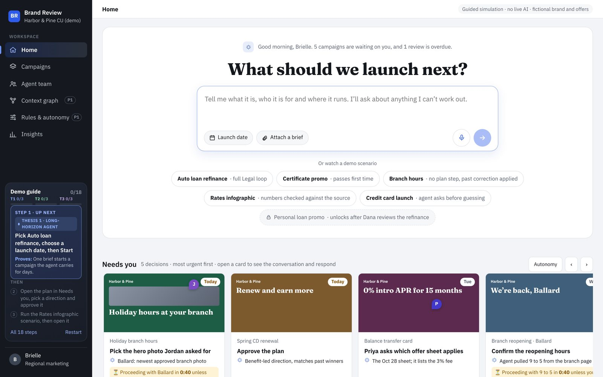
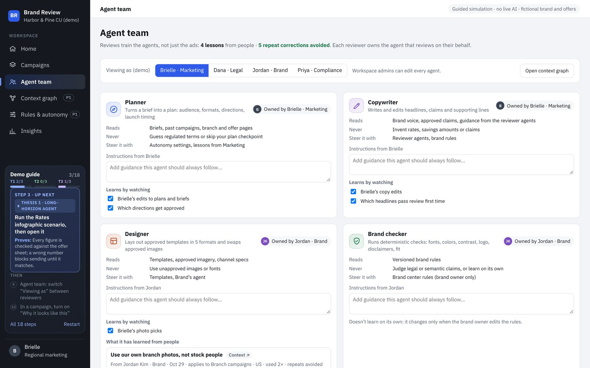
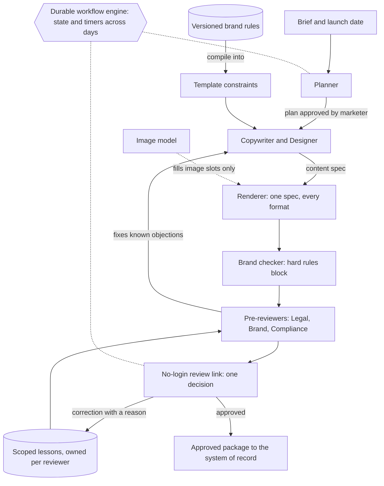

<picture>
  <source media="(prefers-color-scheme: dark)" srcset="../../.github/assets/brand-review-masthead-dark.svg">
  
</picture>

Brand Review is a clickable prototype of an agent that takes a marketing brief to approved, on-brand assets
for a regulated brand. It plans the campaign, builds every format, checks it against brand rules, fixes known
reviewer objections before anyone looks, routes it to Legal, Brand and Compliance with deadlines, and follows
up until it's approved.

**[Open the live demo →](https://brand-review-demo.vercel.app)** No login. Best on a laptop. About 10 minutes.

## The problem

Drafting a campaign with AI now takes minutes. Getting it approved in a bank, credit union or insurer still
takes rounds of Legal, Brand and Compliance review, and each round is a queue. Three things cause most of
those rounds:

1. **Nobody owns the next step.** Work sits between handoffs.
2. **Reviewers enforce rules nobody wrote down.** Legal strikes "guaranteed" from every loan ad, and the same
   fix gets made on every campaign.
3. **Reviewers get whole files with no context.** One miss restarts the loop.

Better generation doesn't touch any of these. So this prototype bets on the review loop instead.
The reasoning, with a model you can rerun, is in
[D-004: what should a content agent fix first?](https://github.com/roy-vinay/ai-decision-log/blob/main/decisions/D-004-what-should-a-content-agent-fix-first.md)

## Three bets

**1. One agent owns each campaign.** It works in short bursts, waits days on people when it has to, and only
brings the marketer decisions: approve a plan, pick between options, send for review. Everything else it does
and logs.

**2. Reviewers teach their own agents.** Legal, Brand and Compliance each own a pre-reviewer. A correction
with a reason becomes a scoped lesson ("could lower, not lower, in lending payment claims") that later drafts
apply before the reviewer sees them. Only a rule's owner can promote a lesson to policy. No model is retrained.

**3. Review is the product.** Known objections are fixed before review. Each reviewer opens a no-login link
and gets one decision, with the reasoning, their own past rulings on similar claims, and a suggested fix.
The agent nudges on the due date, never before a date the reviewer committed to.

Every change the agent makes is explained on the asset, with its source: a brand rule, a reviewer's
correction, an assumption, or a fallback.

## A 10-minute tour

The Demo guide in the left rail walks through this. The short version:

1. Start **Auto loan refinance**, pick a launch date, approve the plan.
2. Watch the specialists build, self-check and fix before review.
3. Send it to Legal, then open **Dana's review link** and correct the payment claim with a reason.
4. Start **Personal loan promo**. The agent applies Dana's lesson before she sees it.
5. In **Agent team**, retire that lesson and run it again: Dana has to repeat herself.
6. Try **Rates infographic**: a chart figure that doesn't match its source blocks sending.

## What's real and what's simulated

| Part | In this prototype |
| --- | --- |
| Agent reasoning and generation | **Simulated.** Scripted steps; no model calls. |
| Workflow, states, handoffs, timers | Real logic in the page, running in your browser |
| Brand checks (contrast, disclaimer, banner length, sourced numbers) | Real checks on the rendered content; edit a headline and they re-run |
| Per-format layouts | Real templates rendering one content spec five ways |
| Lessons and their reuse | Scripted for the demo scenarios |
| Insights page metrics | **Seeded, illustrative.** A worked example of how a pilot would be measured, not results |
| Brand, people, offers | Fictional |

## How it would be built

- **Brand rules compile into template constraints.** Agents fill templates; they don't draw text.
- **Image models fill image slots only.** Text drawn into an image can't be edited or checked.
- **A durable workflow engine** keeps campaign state and timers alive across days of waiting on people.
- **Each agent is a versioned job description** with its own memory and an eval set every edit must pass.
- **Lessons are retrieved, not trained.** Each has an owner, a scope, a reason and a usage count, so it can be
  audited, promoted or retired.

## Decisions and trade-offs

| Decision | Why | Given up |
| --- | --- | --- |
| Hard rules block sending; the 0-100 brand score only advises | A score can create false confidence; a missing disclaimer should never be outweighed | A single number that says "ready" |
| Lessons, not fine-tuning | Auditable, owned, reversible, and scoped per reviewer and product | Generalization beyond what reviewers have corrected |
| Agent asks before guessing on regulated terms | A wrong rate or fee is the worst failure in this domain | Some speed: the marketer gets an extra question |
| Conflicting feedback goes to the marketer | Choosing between Legal and Brand is a human call | Full autonomy on conflicts |
| Publishing always waits for a person | Approval and publishing are different decisions | A fully hands-off pipeline |

## How I'd measure it

Primary: **review rounds per approved campaign set**, paired with **issues missed by review**, because
optimizing rounds alone rewards reviewers for skimming. Secondary: p90 time to approval, first-pass approval,
and repeat corrections per reviewer. Guardrail: zero post-publish compliance violations.

The model in D-004 suggests planning for about **30% fewer rounds**, with 50% as a stretch that needs strong
lesson recall and few novel objections.

## Files

- `index.html`: the whole prototype, one self-contained file. Open it in any modern browser.
- `docs/`: screenshots.
