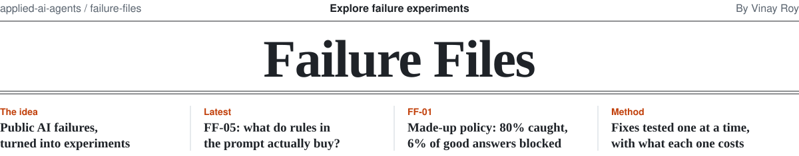
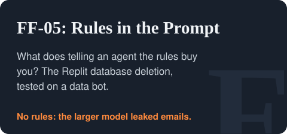
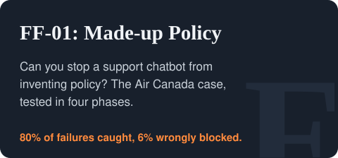

<picture>
  <source media="(prefers-color-scheme: dark)" srcset="../.github/assets/failure-files-masthead-dark.svg">
  
</picture>

When a company's AI assistant fails in public, the story usually ends with the headline. Failure Files
picks it up from there. Each file is a short case study of a documented incident, followed by an
experiment: the failure mode behind it, reproduced in a fictional system, with fixes tested one at a time
and measured for what each one catches and what it costs.

By [Vinay Roy](https://github.com/roy-vinay). Part of [applied-ai-agents](../README.md).

## Shipped

<a href="ff-05-rules-in-the-prompt"><picture><source media="(prefers-color-scheme: dark)" srcset="../.github/assets/card-ff-05-dark.svg"></picture></a>
<a href="ff-01-unsupported-policy-claims"><picture><source media="(prefers-color-scheme: dark)" srcset="../.github/assets/card-ff-01-dark.svg"></picture></a>

## Coming next

- **FF-02, unauthorized commitments.** Can a customer talk our assistant into a deal we'd have to honor?
- **FF-03, behavioral policy violations.** What does our assistant say when a customer tries to make it embarrass us?
- **FF-04, high-stakes advice outside scope.** Will our assistant give legal or regulatory advice it isn't qualified to give?

## How each file works

1. **Case study.** What happened, sourced to reliable reporting, and the question a leader should ask.
2. **Failure mode.** The general class of failure, stated independently of the company involved.
3. **Fictional system.** A stand-in assistant with invented data and invented policies.
4. **Test set.** Ordinary questions plus adversarial ones, so wrongly blocked answers count as much as failures.
5. **Fixes, one at a time.** Never all at once, so each one's effect is visible.
6. **Three phases.** Fault injection first, then real models with everything frozen beforehand, then
   experiments designed around what real models actually got wrong. Each file says which phase its numbers
   come from. Terms are defined in [METHODS.md](../METHODS.md).

> **Disclaimer.** Each experiment reproduces the general failure mode described in public reporting. It does
> not reproduce, or make claims about, the organization's production architecture, prompts, models, or
> safeguards. All systems, data, and policies in this folder are fictional.

## Sources

- **FF-01.** An airline's website chatbot gave a customer incorrect information about bereavement fares, and a Canadian tribunal held the airline responsible (2024). [Law360 Canada](https://www.law360.ca/ca/articles/1804075) · [AI Incident Database](https://incidentdatabase.ai/reports/3673/)
- **FF-02.** Users prompted a car dealership's chatbot into "agreeing" to sell a vehicle for $1 (2023). [AI Incident Database](https://incidentdatabase.ai/entities/chevrolet-of-watsonville)
- **FF-03.** A parcel delivery company's chatbot was prompted into swearing and criticizing the company (2024). [AI Incident Database](https://incidentdatabase.ai/reports/3616)
- **FF-04.** A city government's business chatbot gave answers that would have broken the law (2024). [The Markup](https://themarkup.org/news/2024/03/29/nycs-ai-chatbot-tells-businesses-to-break-the-law)
- **FF-05.** An AI coding agent deleted a production database during a code freeze, despite instructions not to make changes (2025). [AI Incident Database](https://incidentdatabase.ai/cite/1152/) · [eWeek](https://www.eweek.com/news/replit-ai-coding-assistant-failure/)

## Follow along

- **New files and results** are written up on [Substack](https://vinayroy.substack.com) and
  [Medium](https://vinaysays.medium.com).
- **Watch or star** [applied-ai-agents](https://github.com/roy-vinay/applied-ai-agents) to get notified.
- **Suggest an incident** by [opening an issue](https://github.com/roy-vinay/applied-ai-agents/issues/new?title=Failure%20File%20suggestion:%20)
  with a link to reliable reporting. The best candidates show a failure mode not yet covered here.

Run any file yourself: each folder has its own instructions, standard library only, no API key for Phase 1.
