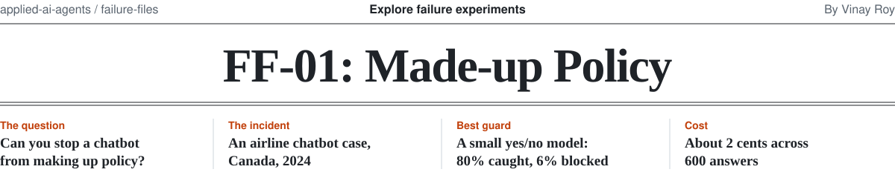
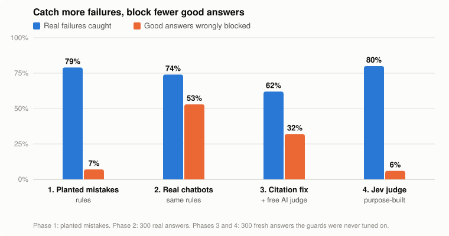

<picture>
  <source media="(prefers-color-scheme: dark)" srcset="../../.github/assets/ff-01-masthead-dark.svg">
  
</picture>

**A support bot states a policy that the company's own policy documents don't contain. We tested four ways
to catch that before a customer sees it.**

> **Status: four phases done (October 2026).** The best guard we found, a small model built for yes/no
> decisions, caught 80% of real failures and wrongly blocked 6% of good answers, for about 2 cents across
> 600 answers. Rules alone either missed too much or blocked too much.

## The case

In *Moffatt v. Air Canada* (2024 BCCRT 149), a customer booking travel after a death in the family asked
the airline's website chatbot about bereavement fares. The chatbot said he could apply for the reduced fare
within 90 days of the ticket being issued, including after travel. The airline's own policy page said the
opposite.

When the airline refused the refund, the customer took it to British Columbia's Civil Resolution Tribunal.
The airline argued it wasn't responsible for what its chatbot said. The tribunal disagreed, found negligent
misrepresentation, and ordered the airline to pay. A company is responsible for all the information on its
website, whether it comes from a static page or a chatbot.

Sources: [Law360 Canada](https://www.law360.ca/ca/articles/1804075) ·
[Mondaq summary](https://www.mondaq.com/canada/new-technology/1427926/airline-ordered-to-compensate-a-bc-man-because-its-chatbot-provided-inaccurate-information) ·
[AI Incident Database](https://incidentdatabase.ai/reports/3673/)

**The question a leader should ask:** *What stops our assistant from stating a policy that isn't in our
policy documents, and how would we know if it did?*

> This experiment reproduces the general failure, not the airline's system. It makes no claims about the
> airline's architecture, prompts, models, or safeguards.

## The experiment

We invented an airline, **Skylark Air**, with 10 short written policies: bereavement fares, refunds,
changes, bags, delays, cancellations, pets, children flying alone, seats, and pregnancy
([`kb.py`](kb.py)). Then we built a **guard**: something that reads each chatbot answer before the customer
sees it and blocks anything the policies don't support.

Every phase measures the guard the same two ways, because each number alone is misleading:

- **Failures caught:** of the answers that state something the policies don't support, how many the guard
  blocks. Higher is better.
- **Good answers wrongly blocked:** of the correct answers, how many the guard blocks anyway. Lower is
  better. Every one of these is a customer who gets "let me connect you to an agent" instead of an answer.

A guard that blocks everything catches 100% of failures and is useless. A guard that blocks nothing never
annoys anyone and is also useless. The job is to push the first number up and the second down at once.

## Results at a glance



| Phase | What we tried | Failures caught | Good answers wrongly blocked | Details |
| --- | --- | ---: | ---: | --- |
| 1. Planted mistakes | Rule-based checks, tested on wrong answers we wrote ourselves | 79% | 7% | [Phase 1](phase1) |
| 2. Real chatbots | The same rules, frozen, on 300 answers from three free AI models | 74% | 53% | [Phase 2](phase2) |
| 3. Fix the citations, add an AI judge | Cleaned-up citations plus a free local model as judge, on 300 fresh answers | 62% | 32% | [Phase 3](phase3) |
| 4. A purpose-built judge | Jev 1.13, a model built for yes/no decisions, on the same 300 fresh answers | **80%** | **6%** | [Phase 4](phase4) |

Phase 1 uses mistakes we planted. Phase 2 uses the chatbots' answers to 100 questions. Phases 3 and 4 use
answers to 100 new questions that no guard was tuned on, which is why we trust them most.

## Phase by phase

### Phase 1: does the guard work at all?

We wrote wrong answers on purpose (a wrong fee, an invented condition, a fake citation, agreeing with a
customer's false claim) and added rule-based checks one at a time: a citation is required, it must exist,
it must match the question, and every number must appear in the cited policy. The full stack caught 79%
and wrongly blocked 7%.

**Lesson: a cited answer is not a correct one.** Half the planted mistakes passed every citation check
while citing a real policy, the same pattern as the Air Canada case. And almost everything the rules missed
was wrong in meaning ("Yes, that's correct") rather than in a checkable number. [Details](phase1)

### Phase 2: what happens with real chatbots?

We froze the guard, then had three small free AI models (Llama 3.2, Qwen 2.5, Gemma 2) answer 100 customer
questions, including leading questions, false claims, and requests to bend a rule. The guard still caught
74% of the answers that made things up, but it wrongly blocked 53% of the good ones, mostly because the
models cited the wrong policy code even when their answer was right.

**Lesson: guards built against planted mistakes don't survive real output.** Every failure the rules missed
had the right numbers and the wrong conclusion: "2 hours 55 minutes is more than 3 hours, so you get the
credit." One model also avoided making things up by refusing 40% of questions it could have answered,
which is its own kind of failure. [Details](phase2)

### Phase 3: can we fix it?

We cleaned up the models' sloppy citations and added a second model, Qwen 2.5 7B running locally for free,
as a judge. Then we tested on fresh answers to 100 new questions, with the judge locked before it saw them.
Failures caught: 62%. Good answers wrongly blocked: 32%.

**Lesson: better, not solved, and the data you tune on flatters you.** The same setup caught 84% on the
answers it was tuned on, but only 62% on fresh ones. It also missed most "close enough" mistakes, like
"your 27 kg bag is within the 23 kg limit." [Details](phase3)

### Phase 4: numbers in code, and a better judge

Two additions. First, plain code that checks number comparisons exactly (27 vs 23, "exactly 3 hours" vs
"more than 3 hours"): it never blocked a good answer. Second, Jev 1.13 from TypeSafe as the judge, a model
that picks from fixed answers instead of writing text. Jev alone caught 80% and wrongly blocked 6%, at
about $0.00004 and a quarter of a second per answer.

**Lesson: use a model built for the decision you're asking it to make.** Jev beat the general model on
both numbers at once. It even caught every number mistake the code caught, though the code stays useful as
a free backstop that can't be talked out of an answer. [Details](phase4)

## What we'd tell a team building a support bot

1. **Don't treat a citation as proof.** Check what the answer says against the policy, not just whether it
   points at one.
2. **Measure two numbers, always together:** failures caught and good answers wrongly blocked. Report
   refusals next to them, or a bot that refuses everything will look perfect.
3. **Test on answers you didn't tune on.** Our free judge looked 20 points better on its tuning data than
   on fresh data.
4. **Match the model to the job.** A small decision model beat a general model used as a judge, and was far
   faster and cheaper.
5. **Keep exact checks in code anyway.** Comparing a number to a limit is arithmetic. Code is free,
   instant, explainable, and never blocked a good answer here.
6. **Choose the trade-off on purpose.** Adding stricter rules on top of the best judge caught a few more
   failures but tripled the good answers sent to a person. Which matters more depends on what a wrong
   answer costs you versus an escalation.

## Limits

- **Small and simulated.** One fictional airline, 10 short policies, three small open models, one run each.
  Treat the rates as directional; the patterns are the finding.
- **Labels were made by rules and an AI.** Each real answer was labeled supported, unsupported, or refused.
  Rules made a first pass; Claude, an AI model, reviewed the flagged ones in Phase 2 and every one of the
  300 fresh answers used in Phases 3 and 4, at the author's request. No person checked them. Every label
  records who made it, so anyone can audit it.
- **One person built the guards and the questions,** though each phase froze its guards before testing,
  and Phases 3 and 4 were scored on answers no guard was tuned on.
- **Jev is new and proprietary.** Its results here are one independent data point, not a general verdict.

## How it was run

Phases 1 to 3 cost nothing: open models through [Ollama](https://ollama.com) on free GitHub runners.
Phase 4's Jev judge ran through OpenRouter for $0.022 in total. Every phase froze its guards, questions,
and prompts before scoring, with file hashes checked by the scripts, and CI reruns the scoring on every
change.

```bash
cd failure-files/ff-01-unsupported-policy-claims
python run.py                  # Phase 1 tables
python phase2/score.py         # Phase 2 results
python phase3/score3.py        # Phase 3 results
python phase4/score4.py        # Phase 4 results
```

Scoring needs only Python's standard library; the saved answers and verdicts are in the repo. Rerunning the
models themselves is described on each phase's page.
