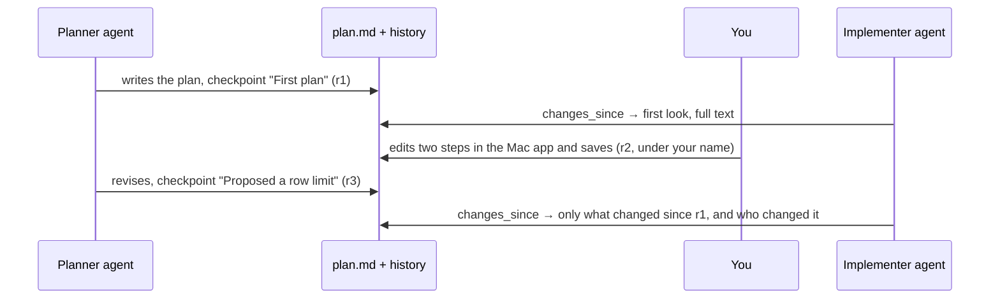
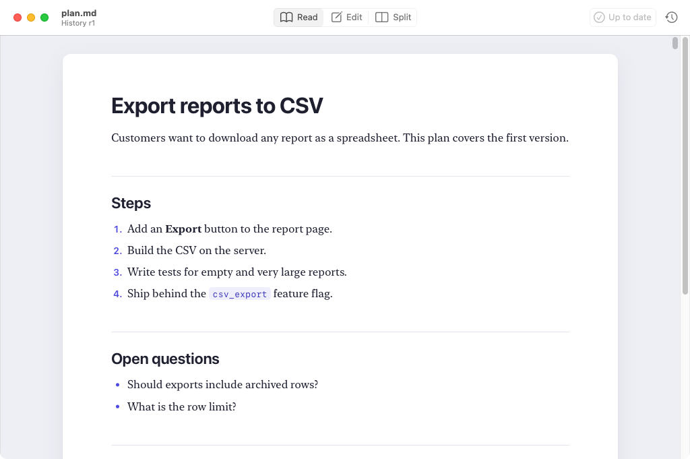
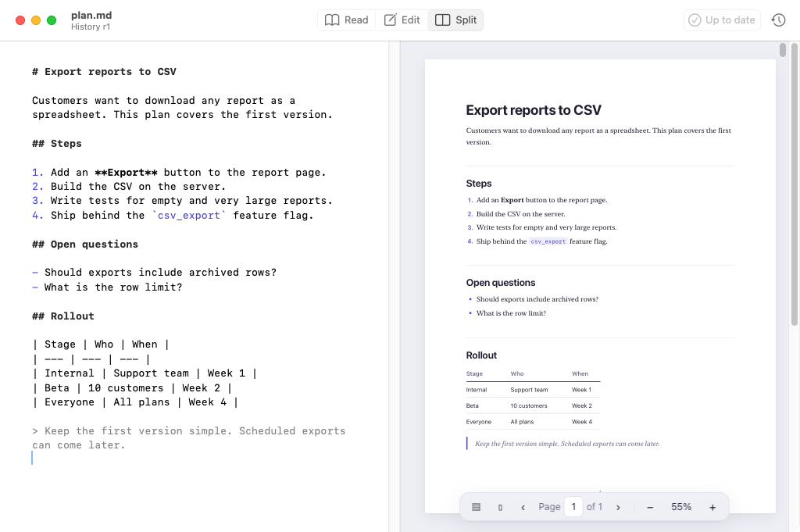
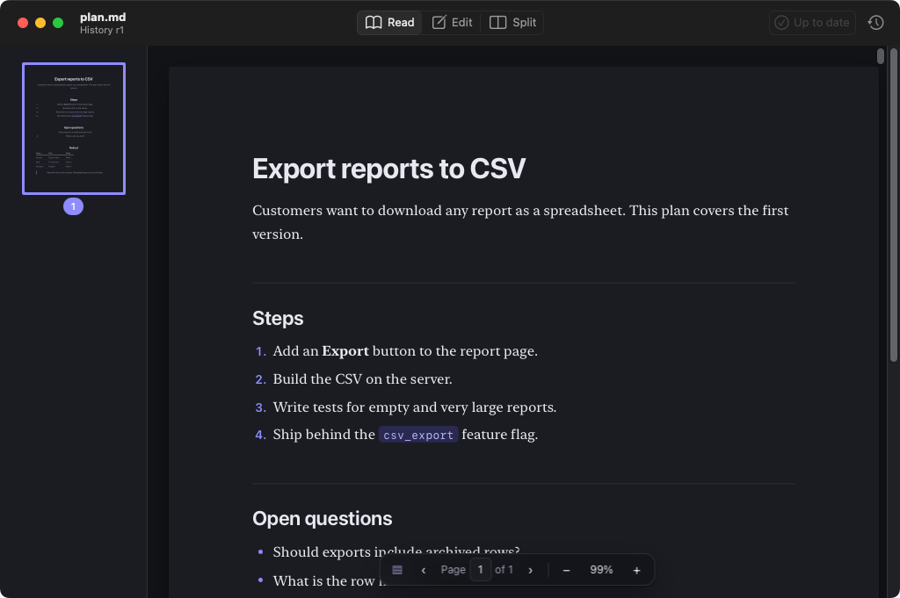

# mdEditDiff

**An editor for people, a diff for agents. See what changed in a Markdown file since you last looked, and who changed it.**

mdEditDiff is a free, open-source tool (MIT license) for anyone who works on Markdown files alongside AI
agents. It has two parts: a command-line tool and MCP server for agents, and a native Mac app for people.

mdEditDiff keeps a private change history for every Markdown file you work on, and remembers where each
reader, agent or person, last looked. Agents ask it what changed and get back only the changed parts,
word by word, with who reported them, instead of re-reading the whole file. People open the same files in
a native Mac app that reads and edits Markdown and records every save in the same history.

[Get it](#get-it) · [See it in action](#see-it-in-action) · [The Mac app](#the-mac-app) · [Use it with an agent](#use-it-with-an-agent) · [Contribute](#contribute)


## The problem

AI agents increasingly coordinate through Markdown files. One agent writes a plan, another implements it,
a person corrects a step, and the first agent revises it again. Coding agents do this constantly with
files like `plan.md`, `spec.md`, `NOTES.md`, `CLAUDE.md` and `AGENTS.md`.

Every one of those readers needs the answer to the same question: **what changed since I last looked, and
who changed it?** Today there is no good way to get it:

- **Re-reading the whole file** costs tokens on every turn, and an agent comparing two long versions in
  its head easily misses a removed sentence.
- **`git diff`** compares against the last commit, not against what *this* reader saw, and agents often
  write many versions between commits. It also shows raw line diffs, where a rewrapped paragraph looks
  like a full rewrite.
- **Notes from the last writer** ("I updated step 3") depend on the writer remembering, and can be wrong.
- **Agent tools' own file tracking** only knows about that tool's reads, not about edits from people or
  other agents.

The result: agents act on stale plans, people can't tell what an agent rewrote, and when two writers edit
at once, the last write silently wins.

## How it works



1. **Every version is kept.** Each time an agent or the app touches a file through mdEditDiff, the file's
   current content is recorded as a revision (`r1`, `r2`, ...) if it changed. The history lives in a
   private folder on your computer, compressed and deduplicated. Nothing is written next to your files.
2. **Every reader has a bookmark.** Each reader name (`planner`, `implementer`, your Mac user name) has its
   own "last looked" revision for each file. Two agents can be at different points and both get correct
   answers.
3. **Answers are about meaning, not bytes.** The file is split into Markdown blocks (headings, paragraphs,
   list items, table rows, code blocks), matched up, and compared word by word inside the blocks that
   changed. Rewrapping a paragraph or renumbering a list isn't a change. Each change says which section
   it's in.
4. **Who changed what is recorded when people say so.** Agents call `checkpoint` with their name and a
   one-line note after editing; the Mac app does this for you on every save. Anything nobody reported is
   labeled "changed outside, not reported", so you always know what is unaccounted for.

Everything stays on your computer. There is no account, no cloud service and no telemetry, and none of
the tools ever modify your files.

## Who it's for and when to use it

| You are | Use it to |
| --- | --- |
| **A developer working with coding agents** (Claude Code, Cursor, Codex) | See exactly what the agent changed in its plan or spec since you last read it, correct it in a proper editor, and get back anything it deleted. |
| **Building multi-agent workflows** | Let a planner, implementer and reviewer share one plan file. Each asks what changed since its last turn instead of re-reading everything, and leaves a note for the next. |
| **Running long agent sessions** | Keep a running log of every version of a living document (`NOTES.md`, `TODO.md`, a design doc), with who changed what, without committing to git every few minutes. |
| **Writing or reviewing docs** | Read READMEs and specs as formatted documents on your Mac, make small fixes, and save without your editor reformatting the whole file. |

When it helps most: any Markdown file that **more than one writer** touches, especially when some of them
are agents. For a file only you edit, the Mac app is still a pleasant reader and editor, but the change
tracking matters less.

## Get it

### The Mac app

Requires macOS 14 (Sonoma) or later, on Apple silicon or Intel.

1. Sign in to GitHub, open the latest
   [mdeditdiff build](https://github.com/roy-vinay/applied-ai-agents/actions/workflows/mdeditdiff.yml?query=branch%3Amain+is%3Asuccess),
   click the top run, and download **mdEditDiff-macOS** under **Artifacts**.
2. Unzip it (it may be zipped twice) and drag **mdEditDiff.app** into **Applications**.
3. Allow it to open the first time. The app isn't notarized by Apple yet, so macOS blocks it with
   *"Apple could not verify mdEditDiff"*. Click **Done**, then either:
   - open **System Settings > Privacy & Security**, scroll down, click **Open Anyway**, and confirm; or
   - run `xattr -dr com.apple.quarantine /Applications/mdEditDiff.app` in Terminal.
4. Open a file: right-click any `.md` file in Finder and choose **Open With > mdEditDiff**. To make it the
   default, select a `.md` file, press ⌘I, pick mdEditDiff under **Open with**, and click **Change All**.

### The command-line tool and MCP server

Requires Node.js 20 or later (check with `node -v`; get it from [nodejs.org](https://nodejs.org)).

```bash
git clone https://github.com/roy-vinay/applied-ai-agents
npm install -g ./applied-ai-agents/tools/mdeditdiff
mdeditdiff --help
```

Connect it to Claude Code:

```bash
claude mcp add mdeditdiff -- mdeditdiff mcp
```

With the tool installed, the Mac app records each save in the shared history, and the window subtitle shows
the current revision (for example "History r4").

## See it in action

The walkthrough plays out the story in the animation above, using a temporary folder with its own history,
so it never touches your files:

```bash
cd applied-ai-agents/tools/mdeditdiff
npm install
npm run walkthrough
```

It walks through six steps: a planner agent writes `plan.md`, an implementer reads it, you edit it without
telling anyone, the planner checks what changed before revising, the implementer asks what changed and gets
back four precise changes, and the full history shows who did what.

To see the Mac app side, open [`examples/plan.md`](examples/plan.md) in mdEditDiff, switch to Edit (⌘2), change a
step, and save. With the command-line tool installed, then run:

```bash
mdeditdiff changes examples/plan.md --reader me      # first time: the full text
# edit and save the file in the app again, then:
mdeditdiff changes examples/plan.md --reader me      # just your edit, labeled with your name
```

## The Mac app

A native macOS reader and editor for Markdown, built for checking and fixing documents that agents write.
It opens files from Finder as formatted documents, and it is careful never to change anything you didn't.



### Three modes

| Mode | Shortcut | What you see | Use it to |
| --- | --- | --- | --- |
| **Read** | ⌘1 | The formatted document, like a web page. Files open in Read mode. | Review a plan or README without Markdown symbols in the way. |
| **Edit** | ⌘2 | The raw Markdown in a plain-text editor with light syntax coloring. | Make changes with full control over the source. |
| **Split** | ⌘3 | The editor on the left and a live preview on the right, updating as you type. | Edit while checking how the result looks. |

⇧⌘M cycles through the modes, and the Read / Edit / Split switch sits at the top right of every window.



### Saving you can trust

- **Nothing changes unless you changed it.** Opening and saving a file without edits writes back the exact
  original bytes. When you do edit, the file keeps its line endings (Unix, Windows or classic Mac), its
  byte-order mark if it had one, and whether it ends with a newline. Your git diffs show only your edit.
- **No surprise autosave.** The app never saves over your file on its own. A dot in the close button means
  unsaved changes, closing asks whether to save, and **File > Revert to Saved** throws edits away.
- **No reformatting.** Smart quotes, smart dashes, auto-correct and auto-links are off, so Markdown and code
  stay exactly as you type them. Paste is always plain text.
- **UTF-8 only, on purpose.** A file in another encoding gets a clear message instead of being converted.

### A preview that's safe to open

- Raw HTML and `<script>` tags in a document are shown as text, never run.
- `javascript:` and other unsafe links are removed.
- Remote images are not downloaded; a notice shows where they would be. Local images load relative to the
  document.
- Web links open in your browser. Links to other `.md` files open in mdEditDiff, and links to anything
  else are shown in Finder rather than opened.

### Shared history

With the command-line tool installed, every save is recorded as a checkpoint under your Mac user name, with
the note "Saved in mdEditDiff". Agents asking `changes_since` then see your edits labeled with your name
instead of "changed outside, not reported", and the window subtitle shows the file's current revision.

### Shortcuts

| Action | Shortcut |
| --- | --- |
| Open / New | ⌘O / ⌘N (new documents open in Edit mode) |
| Read / Edit / Split | ⌘1 / ⌘2 / ⌘3, or ⇧⌘M to cycle |
| Save / Save As | ⌘S / ⇧⌘S |
| Find / Find and Replace | ⌘F / ⌥⌘F |
| Bigger / Smaller / Actual size text | ⌘+ / ⌘− / ⌘0 |

Two settings for now, set in Terminal (a settings window is coming):

```bash
defaults write io.github.roy-vinay.mdeditdiff DefaultMode split   # open files in split (or edit, read)
defaults write io.github.roy-vinay.mdeditdiff Appearance dark     # or light; delete the key to follow the system
```



### Roadmap

- **Changes since you last read**, highlighted in the formatted document, with the agents' notes and
  next/previous navigation.
- **Revision timeline** with compare and one-click restore.
- Warnings when another app changes a file you're editing, Open Recent, and a settings window.

### Build it yourself

Needs Xcode or the Swift toolchain:

```bash
cd tools/mdeditdiff/app
swift test                   # byte-exact saving and editor tests
./scripts/build-app.sh       # creates build/mdEditDiff.app and build/mdEditDiff-macOS.zip
```

## What an agent gets back

From the walkthrough: a planner wrote a plan, a person removed a question, tightened a step and recorded a
decision without telling anyone, and the planner then proposed a row limit and checked in. The
implementer asks what changed:

```
$ mdeditdiff changes plan.md --reader implementer
plan.md: 4 changes (2 modified, 1 added, 1 removed) since r1, your last look, up to r3. Marked as seen.
By: r2 changed outside, not reported; r3 planner: "Proposed a row limit"
Word changes are shown as [-removed-] {+added+}.

~ modified Export reports to CSV > Steps (list-item, line 8)
    Build the CSV on the server{+, streaming rows so large reports never time out+}.
- removed  Export reports to CSV > Open questions (list-item, was line 14)
    - Should exports include archived rows?
~ modified Export reports to CSV > Open questions (list-item, line 14)
    What is the row limit? {+Proposed: 100,000 rows.+}
+ added    Export reports to CSV > Open questions (paragraph, line 16)
    Decision: archived rows are excluded.
```

Four precise changes, each with its section, instead of the whole plan. Unchanged sections are never
repeated. Add `--json` for structured output ([format](docs/FORMAT.md)).

## Use it with an agent

**MCP (Claude Code, Cursor, and other MCP clients).** Add a server that runs `mdeditdiff mcp`, as shown
in [Get it](#the-command-line-tool-and-mcp-server) for Claude Code. In clients configured with JSON:

```json
{ "mcpServers": { "mdeditdiff": { "command": "mdeditdiff", "args": ["mcp"] } } }
```

The server offers six tools: `changes_since`, `mark_seen`, `checkpoint`, `history`, `diff`, and
`get_revision`. None of them changes a file.

**Command line.** Any agent that can run shell commands can use the same operations:

```bash
mdeditdiff changes plan.md --reader implementer        # what changed since I last looked
mdeditdiff checkpoint plan.md --author implementer --note "Split step 4 into two steps"
```

**Tell your agents the protocol.** Paste this into your agent instructions (for example `CLAUDE.md` or
`AGENTS.md`):

> Shared Markdown files (plans, specs, notes) are tracked with mdeditdiff. Use a stable reader name for
> yourself, such as your role. Before working from a shared file, call `changes_since` instead of
> re-reading the whole file. Right after you edit a shared file, call `checkpoint` with your name and a
> one-line note saying what you changed.

## Commands

| Command | What it does |
| --- | --- |
| `changes <file> --reader <name>` | Changes since this reader last looked, then marks the current version as seen. `--peek` leaves the "last looked" point where it is; `--full` adds the full current text. The first call for a reader returns the whole file. |
| `seen <file> --reader <name>` | Marks the current version as seen without showing anything. |
| `checkpoint <file> --author <name> [--note <text>]` | Records the current version with your name and a short note. |
| `history <file>` | Lists revisions, newest first, and where each reader last looked. |
| `diff <file> <from> [<to>]` | Compares any two revisions, for example `r2 r5` or `r2 latest`. |
| `show <file> <revision>` | Prints a revision's full text, for example to recover a deleted section. |
| `watch <file or folder>...` | Keeps running and records a revision each time a Markdown file is saved. |
| `mcp` | Runs the MCP server. |

`--reader` and `--author` can also come from `MDEDITDIFF_READER` and `MDEDITDIFF_AUTHOR`.

## Under the hood

- **Storage.** History lives in a per-user folder (on macOS, `~/Library/Application Support/mdeditdiff`;
  on Linux, `~/.local/share/mdeditdiff`; or `$MDEDITDIFF_HOME`). File contents are stored once each,
  gzip-compressed and named by their SHA-256 hash; a small index per document lists revisions and reader
  bookmarks.
- **Concurrency.** Calls on the same file are serialized with a lock, so several agents can use it at once
  without losing revisions.
- **Limits.** Only Markdown files (`.md`, `.markdown`, `.mdx` and similar) are accepted. Each file keeps up
  to 500 revisions; the oldest are pruned first, except versions a reader still uses as its bookmark.
- **Diff details** and the JSON response format are in [docs/FORMAT.md](docs/FORMAT.md).

## What it can and can't tell you

- **Edits between calls are merged.** If a person and an agent both edit the file before anyone calls
  mdeditdiff, their edits land in one revision. Run `mdeditdiff watch <folder>` in the background, or have
  agents call `changes_since` before they edit, to keep edits separate.
- **Authorship is self-reported.** A checkpoint says who claims a change. mdeditdiff labels everything
  else "changed outside, not reported", and won't let an agent claim a version that may hold someone
  else's edits.
- **One file at a time.** History follows the file's path. Renaming a file starts a new history.
- **UTF-8 only.** Other encodings are refused rather than guessed.
- **Moves are not detected.** A moved paragraph shows as removed in one place and added in another.

## Contribute

mdEditDiff is open source under the MIT license, and contributions are welcome: bug reports, ideas and
pull requests. Open an [issue](https://github.com/roy-vinay/applied-ai-agents/issues) to report a problem or
suggest a feature.

### Develop

```bash
cd tools/mdeditdiff
npm install
npm test    # unit, acceptance, two-agent simulation, concurrency, MCP and preview-renderer tests
npm run walkthrough
```

CI runs the tests on Linux and macOS with Node 20 and 22, builds and tests the Mac app, launches it, and
takes the screenshots on this page. To regenerate the terminal animation:
`./examples/walkthrough.sh | python3 examples/make_terminal_svg.py > docs/img/walkthrough.svg`.

Licensed under the [MIT license](LICENSE). The Mac app bundles [markdown-it](https://github.com/markdown-it/markdown-it)
(MIT) for its preview.
