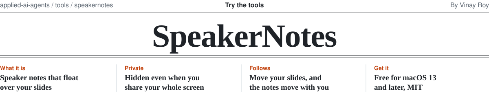
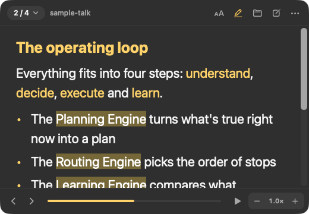
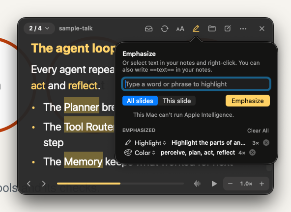
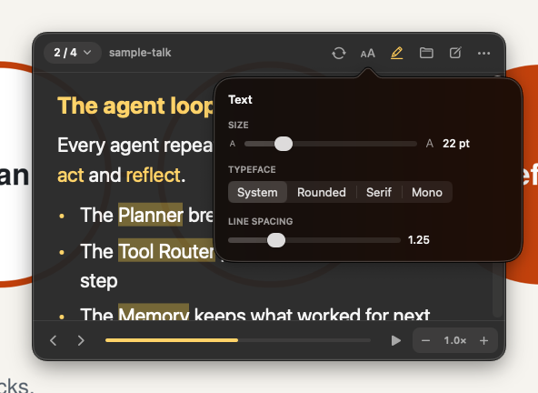
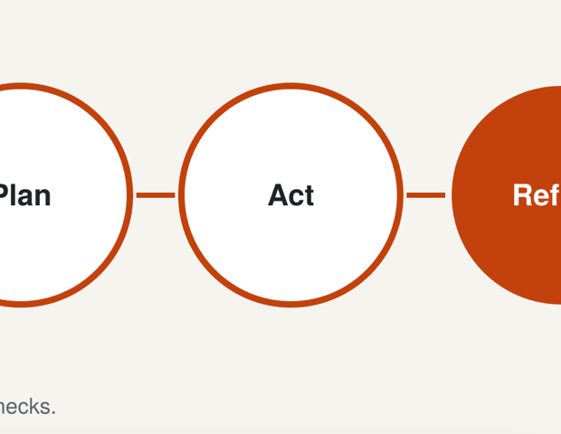
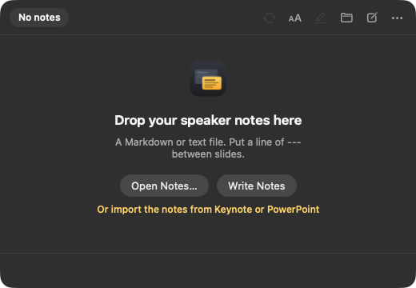
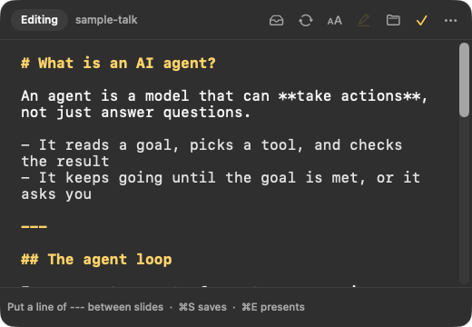

<picture>
  <source media="(prefers-color-scheme: dark)" srcset="../../.github/assets/speakernotes-masthead-dark.svg">
  
</picture>

Speaker notes that float over your slides on Zoom and Google Meet, one slide at a time, and stay out of your
screen share. You see them; your audience doesn't.

<p>
  
  
  
</p>

**[Download for Mac](https://github.com/roy-vinay/applied-ai-agents/releases/download/speakernotes-latest/SpeakerNotes-macOS.zip)** · macOS 13 or later · free, MIT

## The problem

On one laptop screen, Presenter View doesn't survive a full-screen share. Either the share takes over and your
notes disappear, or you share the whole screen and everyone reads your notes. A second monitor fixes it, but not
in a hotel room or on a sales call from the car.

SpeakerNotes is the smallest fix: a small window that sits on top of everything, shows the notes for the slide
you're on, and asks macOS to leave it out of every screen capture. You click your slides as usual. The notes
never move out of the way.

## How it stays out of your share

```
 your screen  →  macOS screen capture  →  Zoom, Meet, recordings
     ↑                    ↑
 notes visible     notes window left out
```

macOS lets an app mark its windows as private to screen capture. SpeakerNotes does that for its notes window,
so a whole-screen share or a recording shows what's underneath instead. CI checks this on every change: it
captures the same part of the screen with hiding off, then on.

<p>
  
  
</p>
<p><sub>Left: hiding off, the notes are captured. Right: hiding on, the same capture shows only what's behind them.</sub></p>

Most video apps honor this, but not every capture method on every macOS version does. Test once on the Mac you
present from (see [Before a real call](#before-a-real-call)). Sharing a single window or tab never includes the
notes either way.

## One slide at a time

Write notes in Markdown with a line of `---` between slides. With no `---` lines, each `#` or `##` heading starts
a new slide. A Word or PDF script converts easily: one heading per slide.

```markdown
# Opening
- Thank everyone for joining
- **The one number:** three hours saved every week

---

## The problem
Pause here. Ask who has seen this before.
```

- **Move between slides from any app.** <kbd>⌃⌥→</kbd> and <kbd>⌃⌥←</kbd> work while your slides are in front.
- **Or let it follow your slides.** Turn on **Move with My Slide Keys** and your usual <kbd>→</kbd> and
  <kbd>←</kbd> move the notes too. macOS asks for Accessibility permission once.
- **Jump anywhere.** Click the slide counter for a list of every slide by title, or click the progress bar.
- **Teleprompter.** <kbd>⌃⌥Space</kbd> scrolls the notes at your pace; <kbd>⌃⌥↑</kbd> and <kbd>⌃⌥↓</kbd> change the speed.
- **Edit in place.** <kbd>⌘E</kbd> switches to editing; edits save back to your file. Edit the file in another app
  and the notes reload.

## Make it easy to read

- **Text.** The **Aa** button sets size, typeface (System, Rounded, Serif, Mono) and line spacing.
- **Emphasis.** Highlight, bold, color or underline a phrase everywhere it appears. Select text and right-click,
  write `==like this==` in your notes, or use the Emphasize panel.
- **Describe it instead.** Type "highlight the names of the engines" and Apple's on-device model reads every slide
  and finds them. It runs on your Mac (macOS 26 with Apple Intelligence), so client scripts never leave it. On
  other Macs, type the exact phrase.

Emphasis is saved beside each file and never changes the file itself.

## Built for a live demo

<p>
  
  
</p>

- **Always one click away.** A Dock icon and a menu bar icon. Clicking the Dock icon always brings the notes back.
- **Ready before the call.** **SpeakerNotes > Open at Login** starts it with your Mac.
- **Comes back where you left it.** If it ever quits, it reopens on the same file and the same slide.
- **Survives a projector.** If a display is unplugged mid-talk, the window moves back onto a screen you can see.
- **Never steals focus.** Clicking your slides keeps them in front. **Click-through** (<kbd>⌃⌥T</kbd>) lets clicks
  pass through the notes entirely, with an amber border so you know it's on.

## Decisions and trade-offs

- **Hide, don't detect.** macOS has no public way to know a share has started, so the notes are always private
  to capture rather than hidden when a share is noticed. Nothing to forget to turn on.
- **The model only finds; code decides.** Instructions return phrases, and a phrase is kept only if it appears
  word for word in your notes. A made-up phrase can't be emphasized.
- **Emphasis beside the file, not in it.** Your notes file stays exactly as you wrote it, so it still works in
  any editor and in version control.
- **No permissions by default.** The global shortcuts need none. Following your slide keys is opt-in because it
  needs Accessibility access.

## Before a real call

Start a Zoom or Meet with just yourself, share your **entire screen**, and record it. If the notes show up in
the recording, share just your slides window instead; the notes then can't appear.

## Shortcuts

**From any app, while your slides are in front**

- <kbd>⌃⌥→</kbd> <kbd>⌃⌥←</kbd> next or previous slide
- <kbd>⌃⌥Space</kbd> start or stop auto-scroll, <kbd>⌃⌥↑</kbd> <kbd>⌃⌥↓</kbd> faster or slower
- <kbd>⌃⌥T</kbd> click-through on or off
- <kbd>⌃⌥N</kbd> show or hide the notes, <kbd>⌃⌥E</kbd> edit or present

**After clicking in the notes**

- <kbd>→</kbd> <kbd>←</kbd> <kbd>Space</kbd> next or previous slide
- <kbd>⌘O</kbd> open a file, <kbd>⌘S</kbd> save, <kbd>⌘E</kbd> edit or present
- <kbd>⌘T</kbd> text settings, <kbd>⌘+</kbd> <kbd>⌘−</kbd> text size
- <kbd>⌘]</kbd> <kbd>⌘[</kbd> less or more see-through

## Status

Early, version 0.2. CI runs on macOS 26 for every change: 12 parser tests, a build for Apple silicon and Intel,
a launch check, screenshots, the screen-capture check above, and a check that the on-device model framework is
linked so the app still opens on macOS 13. Instructions aren't tested in CI, because the build machines can't
run Apple Intelligence.

## Install

Paste this in Terminal. Run it again any time to update; your notes and settings are kept.

```bash
curl -fsSL https://raw.githubusercontent.com/roy-vinay/applied-ai-agents/main/tools/speakernotes/install.sh | bash
```

Or download **[SpeakerNotes-macOS.zip](https://github.com/roy-vinay/applied-ai-agents/releases/download/speakernotes-latest/SpeakerNotes-macOS.zip)**
(always the latest build from main), double-click it, and move **SpeakerNotes.app** to Applications. It isn't
notarized yet, so the first time, right-click it and choose **Open**.

## Build it yourself

```bash
cd tools/speakernotes
swift test                        # 12 tests
./scripts/build-app.sh            # build/SpeakerNotes.app, icon included
open build/SpeakerNotes.app
```

Swift and AppKit, Swift Package Manager, no dependencies. MIT License. [Changelog](CHANGELOG.md).
