<picture><source media="(prefers-color-scheme: dark)" srcset="../../.github/assets/speakernotes-masthead-dark.svg"></picture>

<p align="center"><b>Speaker notes that float over your slides on Zoom and Google Meet.<br>They stay hidden even when you share your entire screen, and they move when your slides move.</b></p>

<p>
<a href="https://github.com/roy-vinay/applied-ai-agents/releases/download/speakernotes-latest/SpeakerNotes-macOS.zip"><picture><source media="(prefers-color-scheme: dark)" srcset="../../.github/assets/btn-speakernotes-download-dark.svg">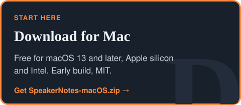</picture></a>
<a href="#install"><picture><source media="(prefers-color-scheme: dark)" srcset="../../.github/assets/btn-speakernotes-install-dark.svg">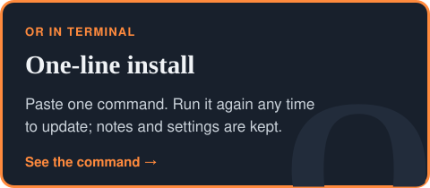</picture></a>
</p>

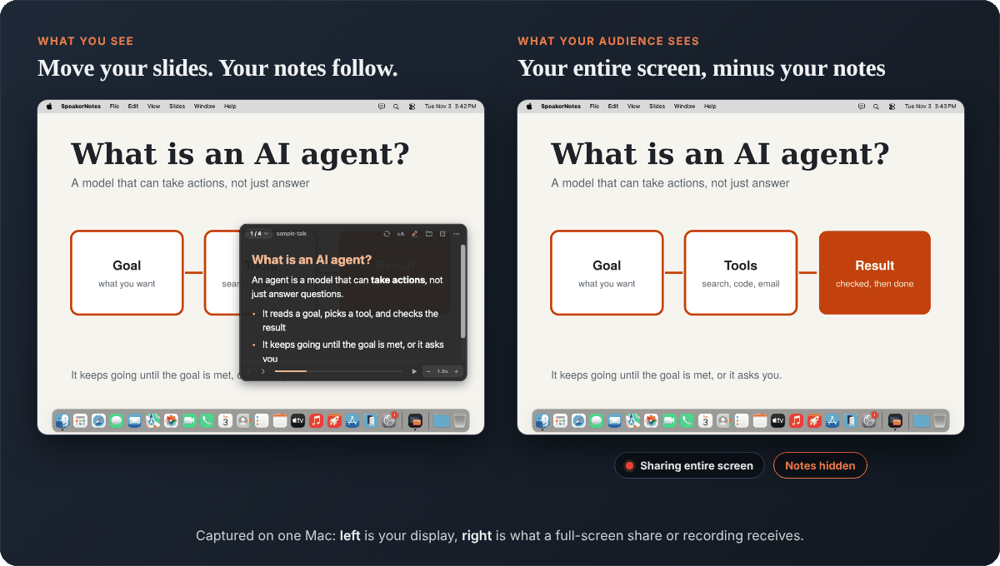

<p align="center"><a href="#share">How it hides</a> · <a href="#slides">Slides</a> · <a href="#follow">Following</a> · <a href="#read">Reading</a> · <a href="#demo">Demo-safe</a> · <a href="#decisions">Decisions</a> · <a href="#shortcuts">Shortcuts</a> · <a href="#install">Install</a></p>

<a name="problem"></a>
<picture><source media="(prefers-color-scheme: dark)" srcset="../../.github/assets/speakernotes-sec-problem-dark.svg"></picture>

<picture><source media="(prefers-color-scheme: dark)" srcset="../../.github/assets/speakernotes-problem-dark.svg">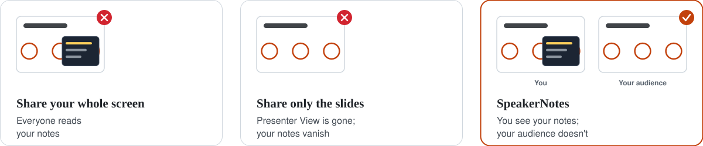</picture>

On one laptop screen, Presenter View doesn't survive a share. SpeakerNotes is the smallest fix: a small window
on top of everything, with the notes for the slide you're on, that macOS leaves out of every capture.

<a name="glance"></a>
<picture><source media="(prefers-color-scheme: dark)" srcset="../../.github/assets/speakernotes-sec-glance-dark.svg"></picture>

<p>
<a href="#share"><picture><source media="(prefers-color-scheme: dark)" srcset="../../.github/assets/speakernotes-glance-private-dark.svg">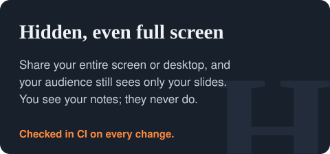</picture></a>
<a href="#follow"><picture><source media="(prefers-color-scheme: dark)" srcset="../../.github/assets/speakernotes-glance-slides-dark.svg">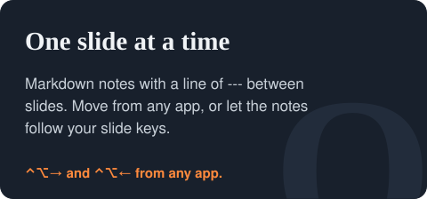</picture></a>
<a href="#read"><picture><source media="(prefers-color-scheme: dark)" srcset="../../.github/assets/speakernotes-glance-readable-dark.svg">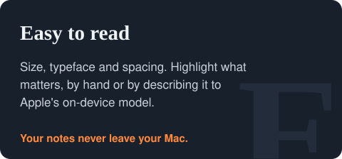</picture></a>
<a href="#demo"><picture><source media="(prefers-color-scheme: dark)" srcset="../../.github/assets/speakernotes-glance-demo-dark.svg">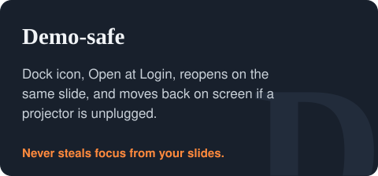</picture></a>
</p>

<a name="share"></a>
<picture><source media="(prefers-color-scheme: dark)" srcset="../../.github/assets/speakernotes-sec-share-dark.svg"></picture>

<picture><source media="(prefers-color-scheme: dark)" srcset="../../.github/assets/speakernotes-share-flow-dark.svg">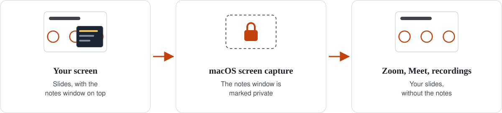</picture>

macOS lets an app mark a window as private to screen capture, and SpeakerNotes does that for its notes window.
That holds when you share your **entire screen or desktop**, not just a window, and in recordings. CI checks it on
every change by capturing the full screen with hiding on and off; the demo at the top is made from those captures.

> [!TIP]
> Test once on the Mac you present from: share your **entire screen** in a call with just yourself, and record it.
> If the notes ever show up, share only your slides window; then they can't appear.

<a name="slides"></a>

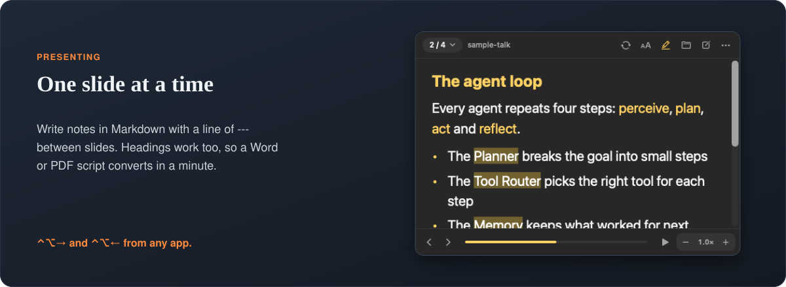

```markdown
# What is an AI agent?
- A model that can **take actions**, not just answer

---

## The agent loop
Perceive, plan, act, reflect. ==Pause here.==
```

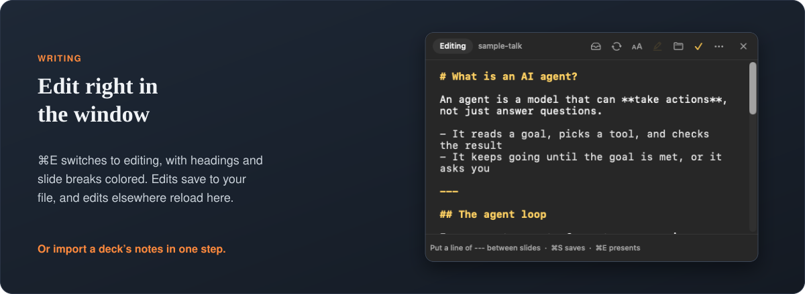

<a name="follow"></a>
<picture><source media="(prefers-color-scheme: dark)" srcset="../../.github/assets/speakernotes-sec-follow-dark.svg"></picture>

<picture><source media="(prefers-color-scheme: dark)" srcset="../../.github/assets/speakernotes-follow-flow-dark.svg">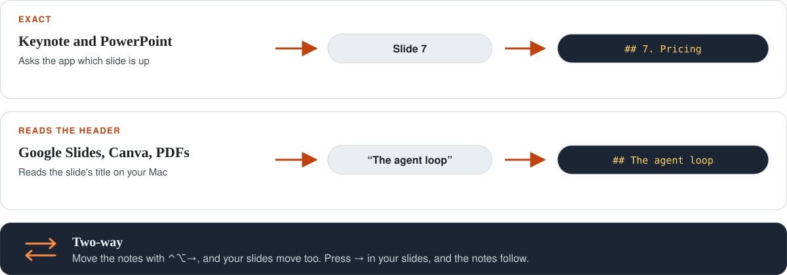</picture>

**Move your slides, and the notes move with you.** Turn on **Follow My Slides** (the ⟳ button, or <kbd>⌃⌥F</kbd>):

- **Exact where it can be.** Keynote and PowerPoint report the slide that's up, even full screen. Numbered headings
  (`## 7. Pricing`) are matched by number.
- **Reads the header everywhere else.** Only the slide's title counts, the notes move only on a clear match, and a
  near-exact title moves them at once.
- **Two-way.** <kbd>⌃⌥→</kbd>, the arrow keys in the notes, or the slide list move your slides too. Moving by hand
  pauses following for a moment.

**Scroll as I speak.** Turn on the waveform button (<kbd>⌃⌥V</kbd>) and the notes scroll as you talk: what you've said
dims and your current line stays near the top. It listens to your microphone only, on your Mac. The recognizer only
supplies words; code decides where you are, so an ad-lib or a misheard word can't throw you to the wrong place, and
scrolling by hand pauses it.

**Park a question.** Press <kbd>⌃⌥P</kbd> from anywhere to note an audience question you promise to return to. It's
saved with the slide, prefilled with what you just said if you're using Scroll as I speak, and the list comes back
on your last slide, ready to copy into the follow-up email.

**Import a deck's notes** with **File > Import Notes from Keynote or PowerPoint**: one numbered heading per slide,
ready to follow. For Google Slides, download the deck as PowerPoint first.

> [!NOTE]
> macOS asks once for **Automation** (to ask Keynote or PowerPoint for the slide), **Screen Recording** (to read
> other apps), **Accessibility** (to move your slides with keys), and **Microphone** and **Speech Recognition** (for
> Scroll as I speak, your voice only). Nothing leaves your Mac.

<a name="read"></a>

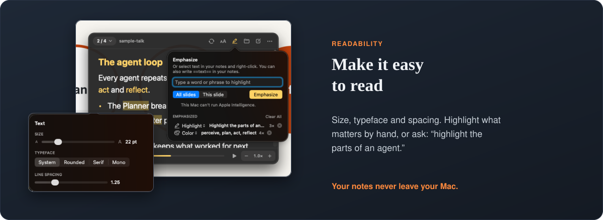

Select text and right-click to highlight, bold, color or underline a phrase everywhere it appears, or write
`==like this==` in your notes. Describing it ("highlight the parts of an agent") uses Apple's on-device model on
macOS 26 with Apple Intelligence. Emphasis is saved beside each file and never changes the file itself.

<a name="demo"></a>
<picture><source media="(prefers-color-scheme: dark)" srcset="../../.github/assets/speakernotes-sec-demo-dark.svg"></picture>

<picture><source media="(prefers-color-scheme: dark)" srcset="../../.github/assets/speakernotes-demo-grid-dark.svg">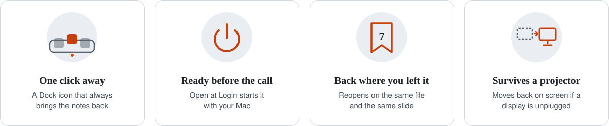</picture>

It never takes focus from your slides, and **Click-through** (<kbd>⌃⌥T</kbd>) lets clicks pass through the notes
entirely, with an amber border so you always know it's on.

<a name="decisions"></a>
<picture><source media="(prefers-color-scheme: dark)" srcset="../../.github/assets/speakernotes-sec-decisions-dark.svg"></picture>

<p>
<picture><source media="(prefers-color-scheme: dark)" srcset="../../.github/assets/speakernotes-decision-hide-dark.svg">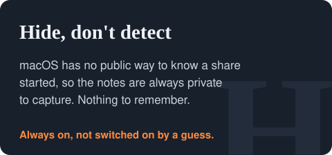</picture>
<picture><source media="(prefers-color-scheme: dark)" srcset="../../.github/assets/speakernotes-decision-model-dark.svg">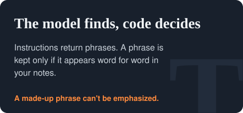</picture>
<picture><source media="(prefers-color-scheme: dark)" srcset="../../.github/assets/speakernotes-decision-file-dark.svg">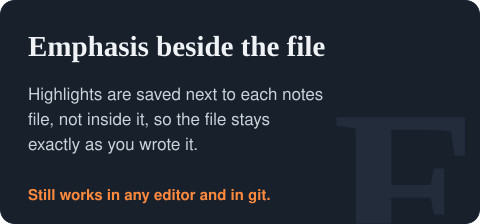</picture>
<picture><source media="(prefers-color-scheme: dark)" srcset="../../.github/assets/speakernotes-decision-permissions-dark.svg">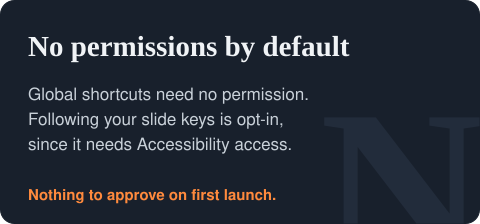</picture>
</p>

<a name="shortcuts"></a>
<picture><source media="(prefers-color-scheme: dark)" srcset="../../.github/assets/speakernotes-sec-shortcuts-dark.svg"></picture>

<picture><source media="(prefers-color-scheme: dark)" srcset="../../.github/assets/speakernotes-shortcuts-dark.svg">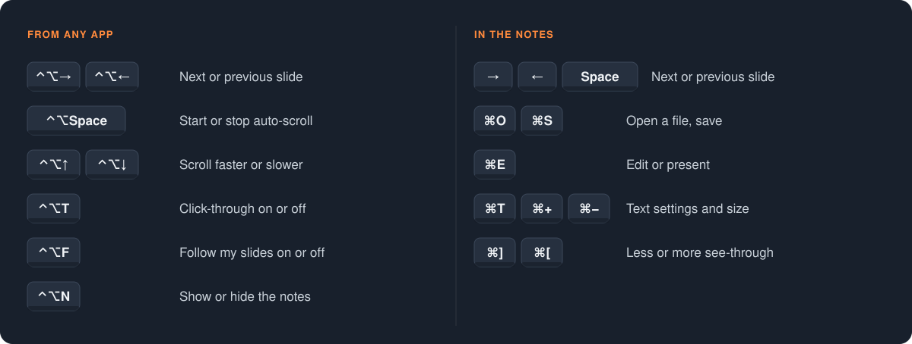</picture>

<a name="status"></a>
<picture><source media="(prefers-color-scheme: dark)" srcset="../../.github/assets/speakernotes-sec-status-dark.svg"></picture>

<picture><source media="(prefers-color-scheme: dark)" srcset="../../.github/assets/speakernotes-status-dark.svg">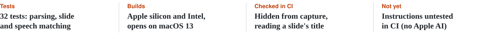</picture>

Early, version 0.5. CI runs on macOS 26 for every change, including reading a sample slide's title and matching it
to the right notes. Keynote, PowerPoint and Apple Intelligence aren't on the build machines, so those paths are
tested by hand.

<a name="install"></a>
<picture><source media="(prefers-color-scheme: dark)" srcset="../../.github/assets/speakernotes-sec-install-dark.svg"></picture>

```bash
curl -fsSL https://raw.githubusercontent.com/roy-vinay/applied-ai-agents/main/tools/speakernotes/install.sh | bash
```

Run it again any time to update; your notes and settings are kept. Or download
**[SpeakerNotes-macOS.zip](https://github.com/roy-vinay/applied-ai-agents/releases/download/speakernotes-latest/SpeakerNotes-macOS.zip)**, double-click it, and move **SpeakerNotes.app** to Applications.

> [!IMPORTANT]
> The app isn't notarized yet. The first time, right-click it and choose **Open**.

<details>
<summary><b>Build it yourself</b></summary>

```bash
cd tools/speakernotes
swift test                        # 32 tests
./scripts/build-app.sh            # build/SpeakerNotes.app, icon included
open build/SpeakerNotes.app
```

Swift and AppKit, Swift Package Manager, no dependencies. After the screenshots change, regenerate the page art with
`roy-vinay/roy-vinay/cards/make_speakernotes_page.py`.
</details>

MIT License · [Changelog](CHANGELOG.md)
