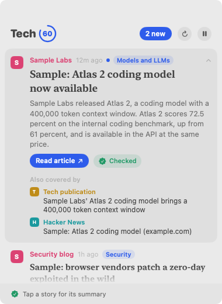

# Tech60

Tech news in 60 words, from the source itself, and checked. A small Mac app that keeps a news card on your desktop.



## What it does

- **A floating card** on your desktop with the latest tech stories. It scrolls gently, pauses when you point at it, and never takes focus from what you're typing.
- **New since you looked:** stories that arrived since you last looked at the card get a dot, and the header counts them.
- **Short summaries from official sources only:** announcements from AI labs and developer platforms (OpenAI, Google DeepMind, Google AI, GitHub Changelog, Apple Developer, Hugging Face) get a summary of up to 60 words, written by Apple's on-device model.
- **Every summary is checked before you see it.** Plain code confirms that every number and name in the summary appears in the source, and that every sentence is backed by a sentence in the source. One failure and the summary is withheld, so you see the headline only. Click **Checked** to see each summary sentence next to the source text behind it.
- **Tap any story for its summary.** Official announcements are summarized in the background. Publisher and Hacker News stories are summarized only when you tap them, on your Mac, with the same checks. **Read article** opens the original.
- **Reads like a newspaper.** A masthead with today's date and edition, section tabs (Top, Latest, and your topics), a lead story with its picture, and the rest with thumbnails. A small ring shows how hot each story is, and every story says when it was first reported and by whom. Open one for its checked summary and the full coverage, earliest first. Light and dark follow macOS.
- **Hot or Latest.** Hot (the default) ranks stories by heat: how many outlets cover it, Hacker News points and comments, and whether Techmeme picked it, cooling with age. Quiet single-outlet stories are left out. Latest shows everything, newest first.
- **One row per story, not per source.** When the company's post, The Verge, and Hacker News all cover the same launch, you see one row with the other sources tucked inside.
- **Topics you follow.** Pick topics like AI agents, Apple, or chips (or add your own words). Matching stories move to the top and the rest are dimmed.
- **Daily brief.** Pick a time and get one notification with the five stories that matter most since your last brief. Click it to see them on the card.
- **Refresh any time.** Tech60 checks sources every 15 minutes; the refresh button on the card (or ⌘R) checks now.
- **Private:** no account, no tracking. Summaries run on your Mac; nothing is sent to a cloud model.

## Requirements

- macOS 14 or later for the card.
- Summaries need macOS 26 with Apple Intelligence turned on. Without it, every story shows headline and link.

## Install

1. Download **[Tech60-macOS.zip](https://github.com/roy-vinay/applied-ai-agents/releases/download/tech60-latest/Tech60-macOS.zip)** (the latest build from main) and double-click it.
2. Drag **Tech60.app** into Applications and open it. The app isn't notarized yet, so the first time macOS blocks it: open **System Settings > Privacy & Security** and click **Open Anyway**.
3. Tech60 lives in the menu bar (newspaper icon). Use it to show or hide the card, pause, refresh, pin the card above other windows, and open **Sources, topics, and brief**.

## How it gets the news

Only feeds that sites publish themselves (RSS and Atom), plus Hacker News through its official API. Tech60 never scrapes a site that has no feed. For official announcements whose feed carries only a sentence or two, Tech60 reads the announcement page the feed links to, and only to write the summary.

## Status

Version 0.1, an early build. Summaries are **experimental**: the accuracy evaluation in the PRD (at least 200 labeled source documents, published results) hasn't been run yet. Until then, treat each summary as a pointer to the source, and use **Why?** when it matters.

## Build it yourself

```bash
cd tools/tech60
swift test
./scripts/build-app.sh   # builds build/Tech60.app
./build/Tech60.app/Contents/MacOS/Tech60 --demo   # sample stories, no network
```

MIT License.
