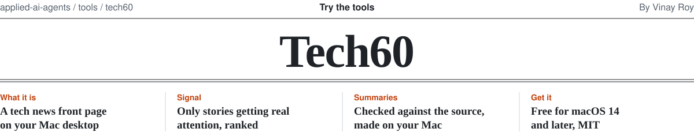
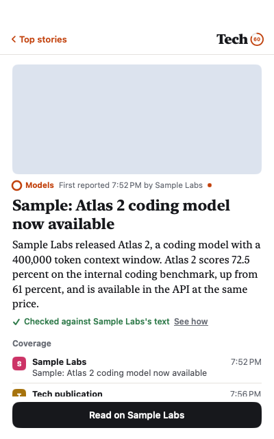
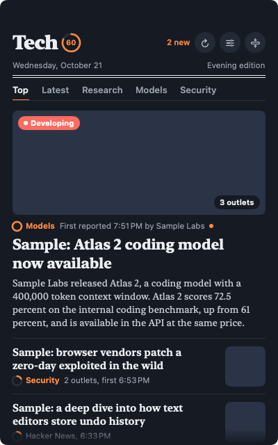

<picture>
  <source media="(prefers-color-scheme: dark)" srcset="../../.github/assets/tech60-masthead-dark.svg">
  
</picture>

A tech news front page that lives on your Mac desktop. It shows only stories with real signal, ranks them by how
much attention they're getting, and gives each one a short summary that must pass rule-based checks against
the source before you see it. Everything runs on your Mac.

<p>
  
  
  
</p>

**[Download for Mac](https://github.com/roy-vinay/applied-ai-agents/releases/download/tech60-latest/Tech60-macOS.zip)** · macOS 14 or later · free, MIT

## The problem

Keeping up with tech means checking Techmeme, Hacker News, and a handful of company blogs, then skimming past
deals, reviews, and the same launch written up five times. AI summaries could help, but a summary that invents
a number is worse than no summary. And there is no good tech news widget for the Mac desktop.

Tech60 is the smallest version that tries to fix those three things: pick what matters, say it briefly, and
withhold a summary when simple checks show it straying from the source.

## How it decides what's news

```
 feeds and HN API  →  noise filter  →  same story, one row  →  heat  →  on-device editor  →  Top
```

1. **Sources.** Feeds that sites publish themselves, plus Hacker News through its official API. Techmeme
   anchors the mix because its editors already pick what matters. Company posts (OpenAI, Google DeepMind,
   Google AI, Hugging Face) are the primary sources; TechCrunch, MIT Technology Review, Platformer, The Verge,
   and Ars Technica add coverage. New AI and language papers come from arXiv, once every six hours. Tech60
   never scrapes a site without a feed.
2. **Noise filter.** Drops deals, reviews, buying guides, how-tos, gaming, and reference pages like Wikipedia
   or fan wikis. Hacker News stories need 150 points; Show HN and Ask HN need 400.
3. **One row per story.** When the company post, The Verge, and Hacker News cover the same launch, they become
   one row. Headlines are matched on their distinctive words; words that appear in many headlines that day
   count for less, so two different Apple stories don't merge.
4. **Heat.** Each extra outlet and a Techmeme pick count most. Hacker News points help but are capped, so a
   popular essay can't outrank real news. Heat cools with age, like Hacker News's own ranking.
5. **The editor.** Apple's on-device model rates each new headline 1 to 5 on one question: would a technology
   professional need to know this today? Anything rated 2 or lower stays out of Top and the daily brief.
6. **Top.** Only rows with real signal: two or more outlets, a Techmeme pick, the company's own post, or 400+
   Hacker News points. There is no filler. On a quiet morning Top is short and says so; Latest has everything.

**Research.** arXiv papers have their own tab, newest first. Open one and you get a plain-English explainer in
four parts: the problem, what the authors did, what they found, and why it matters. It's written on your Mac from
the abstract plus the paper's introduction and conclusion. Numbers and names in every part, and each sentence of
the findings, are checked against the paper; "why it matters" is labeled as the model's read. A paper
joins Top and Latest only when the news picks it up: today, a Hacker News post linking to it with 150 or more
points. arXiv's titles and abstracts are public domain (CC0), and its terms ask for no more than one request
every three seconds; Tech60 asks once every six hours.

You tune it with a right-click: **More like this** or **Less like this** adjusts the weight of that story's
words and source, and stays on your Mac.

## How summaries are checked

Summaries come from Apple's on-device model (macOS 26 with Apple Intelligence). Before one is shown, plain code
checks it against the source text:

- every number and every proper name in the summary appears in the source,
- every sentence shares at least half its content words with a sentence in the source,
- no negation appears that the source doesn't have,
- and it is 60 words or fewer.

One failure and the summary is withheld; you see the feed's own text instead, labeled as such. **See how**
shows each summary sentence next to the source sentence behind it.

These checks catch invented numbers and names and sentences with no basis in the source. They don't catch
everything: a summary can pass and still leave out context or shift emphasis. How often that happens hasn't been
measured yet (see Status).

The top ten stories are summarized in the background after each refresh, and resting the pointer on a story
starts its summary, so most open instantly.

## What else is on the card

- A newspaper layout: masthead with the date and edition, section tabs for Top, Latest, and topics you follow,
  a lead story with its picture, and thumbnails for the rest.
- A heat ring on every story, **Developing** when three or more outlets pick a story up within three hours, and
  when it was first reported and by whom.
- New since you looked: a dot on new stories and a count in the masthead and menu bar.
- A daily brief: one notification at the time you choose with the five stories that matter most.
- Light and dark follow macOS. No account, no tracking, no cloud model.
- Collapse to a ticker or a dot. The card shrinks into a one-line ticker (⌘⇧T) whose headlines scroll continuously,
  or into a small dot (⌘⇧.) that glows when new stories arrive. Click either to come back to exactly where the
  card was. The ticker starts at the bottom of the screen and snaps to the top or bottom edge, or floats anywhere
  (hold ⌥ to skip snapping); Tech60 remembers where you left it on each display. Both stay above other windows
  and on every Space, and the options menu turns either off.
- Hidden from screen sharing. Tech60's windows are left out of screen captures, so people watching a
  whole-screen share or a recording don't see them while you still do. Sharing a single tab or window never
  includes Tech60 anyway.

## Decisions and trade-offs

- **Headlines and links only for publishers.** Tech60 summarizes a publisher's story only when you open it, on
  your Mac, and always links to the original.
- **The editor can only remove, never add.** A model that promotes stories could be gamed by clickbait;
  one that only demotes fails safe.
- **No filler in Top.** A short Top on a slow day is more honest than padding it with whatever is left.
- **Rules before models.** The noise filter and the summary checks are plain code with tests, so a false
  positive can be traced to a line.

## Status

Early, version 0.1. 45 unit tests run in CI on every change, covering feed parsing, clustering, heat, the noise
filter, the editor's parsing, and the summary checks. The accuracy evaluation of the summaries themselves (at
least 200 labeled source documents, with published results) hasn't been run yet, so treat each summary as a
pointer to the source until then.

## Install

1. Download **[Tech60-macOS.zip](https://github.com/roy-vinay/applied-ai-agents/releases/download/tech60-latest/Tech60-macOS.zip)**
   (always the latest build from main) and double-click it.
2. Move **Tech60.app** to Applications and open it. The app isn't notarized yet, so the first time, right-click
   it and choose **Open**.
3. The card appears on your desktop and the Tech60 icon in the menu bar. Settings (sources, topics, daily
   brief) are behind the slider button on the card.

## Build it yourself

```bash
cd tools/tech60
swift test                                        # 45 tests
./scripts/build-app.sh                            # build/Tech60.app, icon included
./build/Tech60.app/Contents/MacOS/Tech60 --demo   # sample stories, no network
```

Swift and SwiftUI, Swift Package Manager, no dependencies. MIT License.
